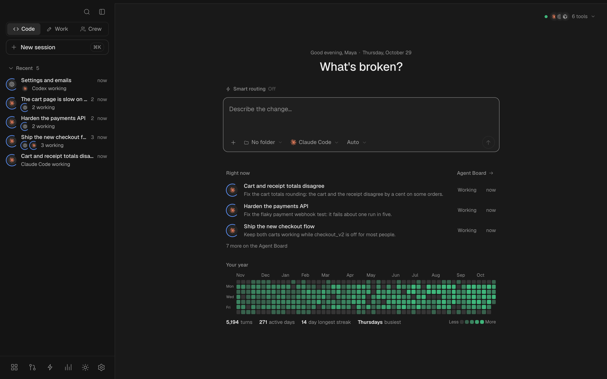
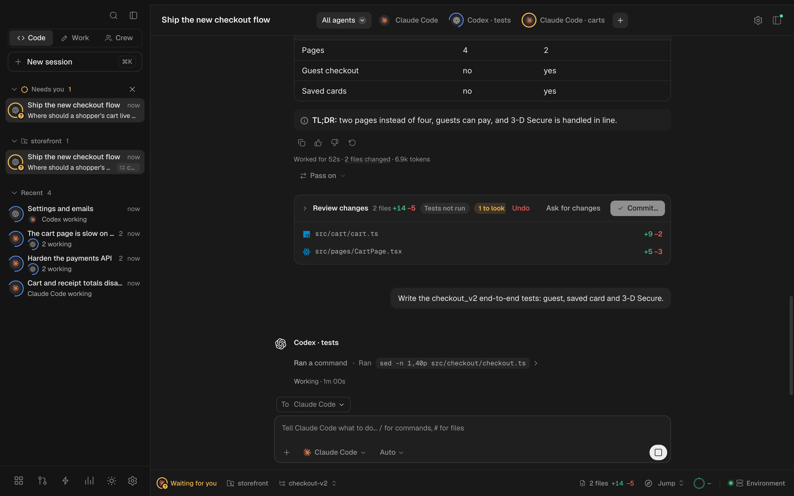
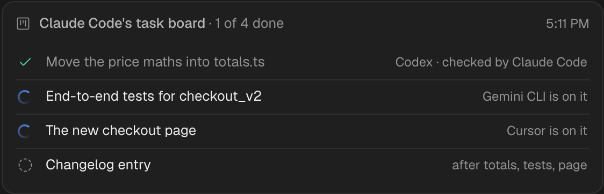
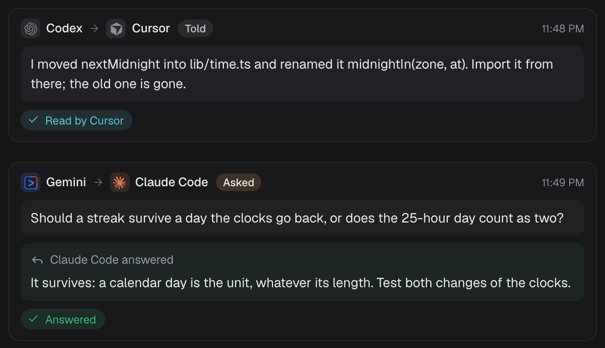
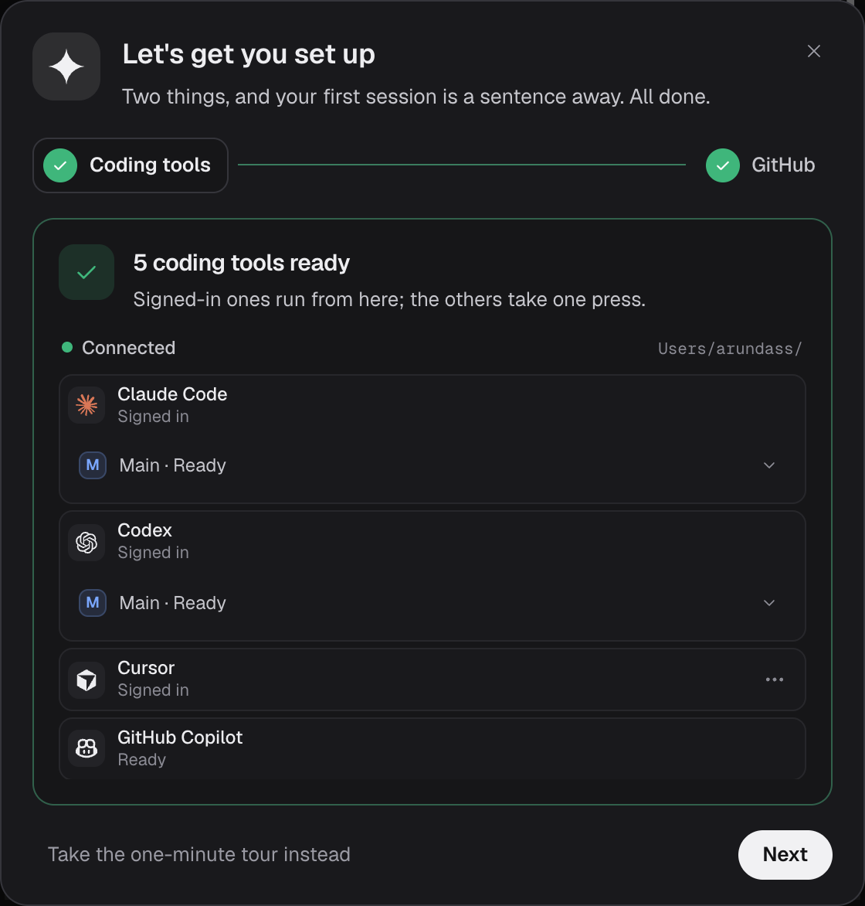
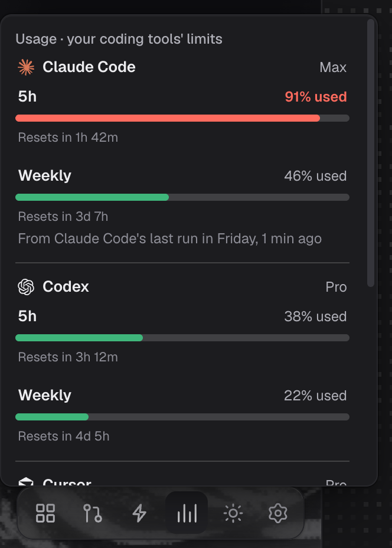
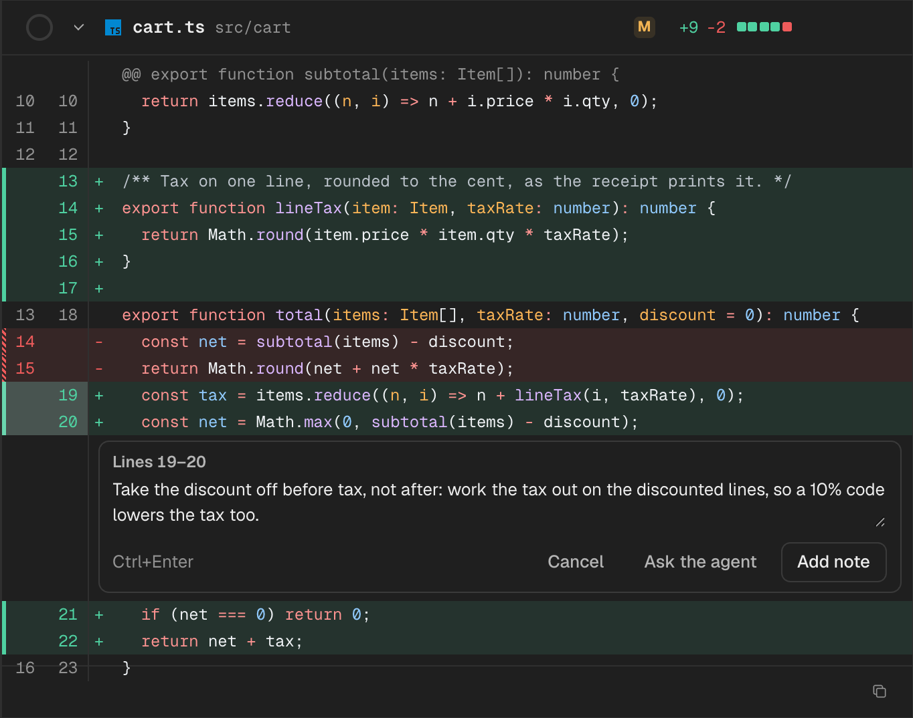
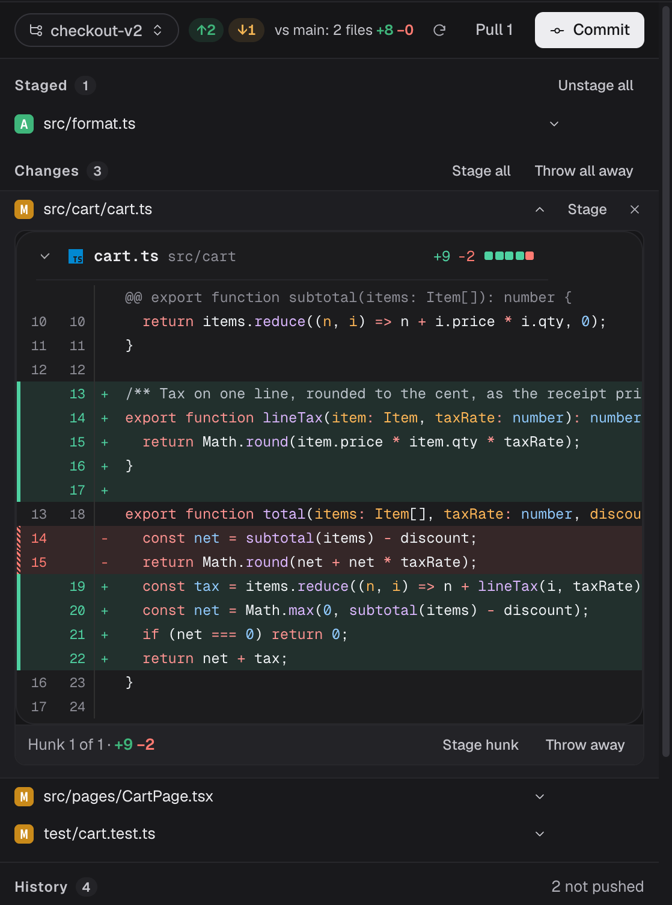
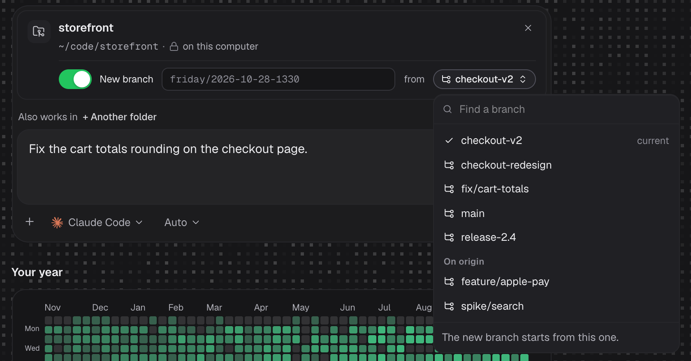

<p align="center">
  
</p>

<h1 align="center">Friday</h1>

<p align="center">
  <strong>The open-source harness for coding agents that work as a team.</strong><br/>
  Run Claude Code, Codex, Cursor, Gemini CLI, GitHub Copilot and more from one place. They split the work on a shared task board, message each other as they go, hand off when one hits its usage limit, and you review it all before it ships.
</p>

<p align="center">
  <a href="https://github.com/splashxmoon/friday/stargazers"></a>
  
  
  <a href="https://github.com/splashxmoon/friday/actions/workflows/ci.yml"></a>
</p>

<p align="center">
  <a href="https://github.com/splashxmoon/friday/releases/latest/download/Friday-arm64.dmg"><b>Mac (Apple silicon)</b></a> ·
  <a href="https://github.com/splashxmoon/friday/releases/latest/download/Friday-x64.dmg"><b>Mac (Intel)</b></a> ·
  <a href="https://github.com/splashxmoon/friday/releases/latest/download/Friday-Setup.exe"><b>Windows</b></a> ·
  <a href="https://github.com/splashxmoon/friday/releases/latest/download/Friday-x86_64.AppImage"><b>Linux</b></a>
  <br/>or, with Node.js 22: <code>npx github:splashxmoon/friday</code>
</p>

<p align="center">
  
</p>

Works with the subscriptions you already have. If a coding tool is installed and signed in on your computer, Friday can drive it:

<p>
  <kbd> Claude Code</kbd>
  <kbd> Codex</kbd>
  <kbd> Cursor</kbd>
  <kbd> GitHub Copilot</kbd>
  <kbd> OpenCode</kbd>
  <kbd> Gemini CLI</kbd>
  <kbd> Devin</kbd>
  <kbd> Junie</kbd>
  <kbd> Kiro</kbd>
  <kbd> Factory Droid</kbd>
  <kbd> Grok Build</kbd>
  <kbd> Cline</kbd>
  <kbd> Kilo</kbd>
  <kbd> Amp</kbd>
  <kbd>Any ACP agent</kbd>
</p>

## Your agents, working as a team

Friday doesn't just run your coding tools next to each other: it lets them work together. One agent can split a job into a **task board**; the others pick up the tasks that suit them, each in its own files, and every finished task is checked (its tests run, another agent reviews it) before it counts as done. Along the way they **message each other** directly: a heads-up about a rename, a question one of them waits on, an answer that comes back. You see every message as it happens.

<p align="center">
  
</p>

An agent you add to a session can work in its own copy of the repository, so three of them can change the same project at once without stepping on each other.

<table>
<tr>
<td width="50%"></td>
<td width="50%"></td>
</tr>
<tr>
<td width="50%" valign="top"><sub><b>A shared task board.</b> Claude Code split the work; Codex finished its part and Claude Code checked it; Gemini and Cursor are on theirs; the last task waits for all three.</sub></td>
<td width="50%" valign="top"><sub><b>Agents talking.</b> Codex tells Cursor what it renamed before Cursor trips over it; Gemini asks Claude Code how a 25-hour day should count, and goes on with the answer.</sub></td>
</tr>
</table>

## "So what's the catch?"

There isn't one. Friday on your own computer is free and MIT licensed. It has no account, no server of ours, and no model of its own: the work runs on your coding tools, on their own plans, and nothing comes back to us.

What we sell is [Friday Team](https://www.tryfridaywork.com), the hosted version, for when several people work in the same session: steering one agent together, reviewing each other's changes, and sharing what the agents did.

## Install

> [!IMPORTANT]
> Install and sign in to at least one coding tool first. Friday finds every one on your computer and can sign the rest in from its setup screen.
>
> - Claude Code: `claude auth login`
> - Codex: `codex login`
> - Cursor: `cursor-agent login`
> - GitHub Copilot: `copilot login`
> - OpenCode: `opencode auth login`
> - Gemini CLI: run `gemini` once and sign in

### The desktop app

| | |
| --- | --- |
| Mac, Apple silicon | [Friday-arm64.dmg](https://github.com/splashxmoon/friday/releases/latest/download/Friday-arm64.dmg) |
| Mac, Intel | [Friday-x64.dmg](https://github.com/splashxmoon/friday/releases/latest/download/Friday-x64.dmg) |
| Windows | [Friday-Setup.exe](https://github.com/splashxmoon/friday/releases/latest/download/Friday-Setup.exe) |
| Linux | [Friday-x86_64.AppImage](https://github.com/splashxmoon/friday/releases/latest/download/Friday-x86_64.AppImage) (`chmod +x` it, then run it) |

On a Mac, Homebrew installs it too:

```bash
brew tap splashxmoon/friday https://github.com/splashxmoon/friday
brew trust splashxmoon/friday
brew install --cask friday
```

Every version is on the [releases page](https://github.com/splashxmoon/friday/releases). The app is Friday in a window of its own, with the same server inside it, on `127.0.0.1` only.

> [!NOTE]
> Until the installers are signed, your computer will ask before opening one. On Windows, choose **More info**, then **Run anyway**. On a Mac, if it says Friday is damaged or can't be checked, move it to Applications and run `xattr -dr com.apple.quarantine /Applications/Friday.app` once.

### From a terminal

With Node.js 22 or newer and Git:

```bash
npx github:splashxmoon/friday
```

Friday opens in your browser at `http://127.0.0.1:4321`. To keep a copy:

```bash
git clone https://github.com/splashxmoon/friday
cd friday
npm install
npm start
```

| Setting | Default | What it does |
| --- | --- | --- |
| `PORT` | `4321` | Where Friday listens, on this computer only. |
| `FRIDAY_HOME` | `~/.friday` | Where it keeps your sessions and settings. |
| `--no-open` | | Start without opening the browser. |

## Features

<table>
<tr>
<td width="50%" valign="middle">

### Every coding tool, one place

Friday finds the coding tools on your computer and whether each is signed in. Pick one per task, or let Auto choose by the job and by how much of each tool's usage is left.

</td>
<td width="50%"></td>
</tr>
<tr>
<td width="50%" valign="middle">

### Never stuck on a usage limit

Each tool's remaining usage, always in view. When one runs out mid-task, the task moves to the agent best placed to finish it, with everything done so far, instead of starting over.

</td>
<td width="50%"></td>
</tr>
<tr>
<td width="50%" valign="middle">

### Review before anything ships

Every run ends in a change set you read before you keep it. Leave notes on a line or a range and send them back to the agent; see which lines it wrote and which you did.

</td>
<td width="50%"></td>
</tr>
<tr>
<td width="50%" valign="middle">

### Git, built in

Stage by file or by hunk, commit, pull, push, and open a pull request, stacked on another one if you are building in steps. Start any session on the branch you choose.

</td>
<td width="50%"></td>
</tr>
<tr>
<td width="50%" valign="middle">

### Pick the branch, or start a new one

Point a session at a folder, choose the branch it works on, or have it start a new branch from any other. Friday won't switch a folder with uncommitted work out from under you.

</td>
<td width="50%"></td>
</tr>
</table>

Also in the box: a live feed of every message, command and file change; approvals when a tool asks before running something; your dev server previewed beside the session; skills and saved commands shared across your tools; and sessions your tools come back to by themselves after a restart.

## Privacy

Friday listens on `127.0.0.1` only, so nothing else on your network can reach it, and it answers only its own page: a request from any other site, or from a page being previewed, is refused. What it keeps is one folder on your computer, readable only by you.

It sends nothing to us: no account, no analytics, no telemetry. It talks to GitHub for the pull requests, issues and skills you ask it about, and reads each coding tool's remaining usage from that tool's own provider, with the sign-in the tool already has. The desktop app also asks GitHub which release is the latest, twice a day, so it can tell you when there's a new one (`FRIDAY_NO_UPDATE_CHECK=1` turns that off).

## Developing

```bash
npm install
npm run typecheck
npm test
npm run build:css    # after changing styles
npm run desktop      # build the desktop app and open it
npm run desktop:dist # package installers for this computer into release/
```

Pushing a `v*` tag builds the installers for every platform on GitHub Actions and publishes them as a release ([release.yml](.github/workflows/release.yml)).

Issues and pull requests are welcome: [CONTRIBUTING.md](CONTRIBUTING.md) says how. For anything large, open an issue first so we can talk it through.

## FAQ

**How do I run Claude Code and Codex at the same time on one project?**
Start a session in your repository with one of them, then add the other from the session's agent bar. Each can work in its own copy of the repository (a Git worktree), so they don't overwrite each other, and Friday keeps them talking.

**Is this a multi-agent framework I have to code against?**
No. Friday drives the coding CLIs you already use, as they are. There's nothing to write: you pick the tools and give them the job.

**Which coding agents does it support?**
Claude Code, Codex, Cursor, GitHub Copilot, Gemini CLI, OpenCode, Devin CLI, Junie, Kiro, Factory Droid, Grok Build, Cline, Kilo Code, Amp, and any agent that speaks the Agent Client Protocol (ACP).

**Does it cost anything, or use my API keys?**
Friday is free and MIT licensed. The work runs on each tool's own plan and sign-in, so there are no keys to paste and nothing extra to pay.

**What happens when one agent runs out of usage?**
Its task goes to the agent best placed to finish it, with its notes, files and plan, so the work keeps going.

**Does my code leave my computer?**
Not through Friday. It runs on `127.0.0.1` with no account and no server of ours; your coding tools talk to their own providers as they always do.

---

If Friday saves you time, a ⭐ helps other people find it.

## License

[MIT](LICENSE)
