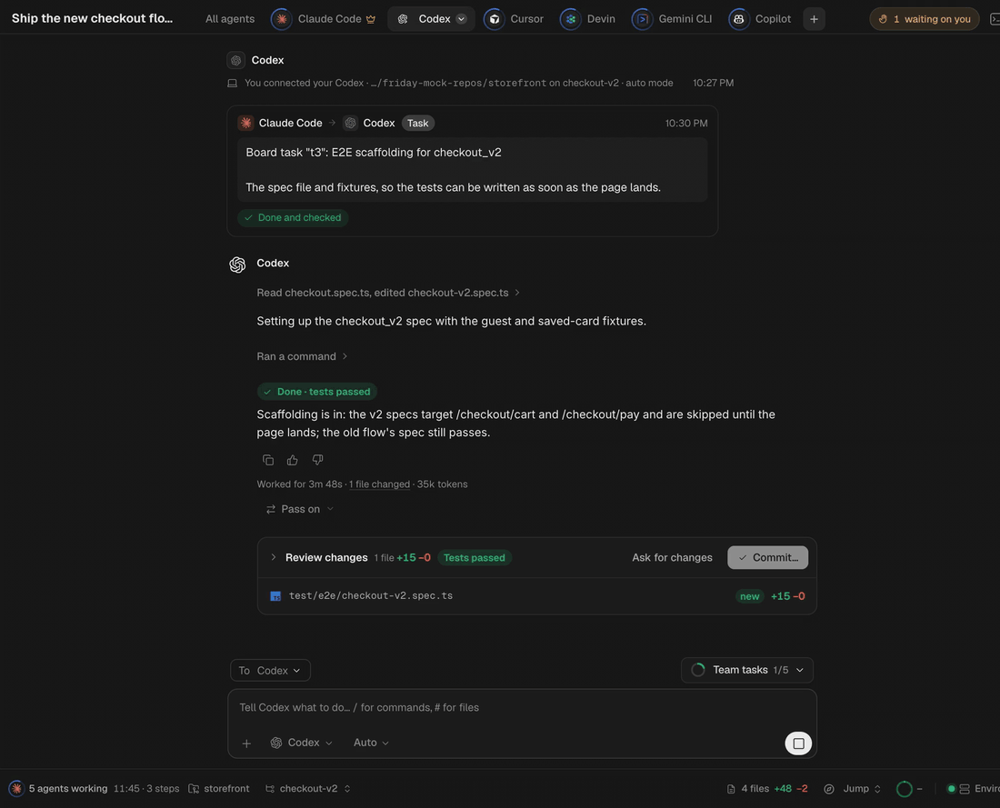
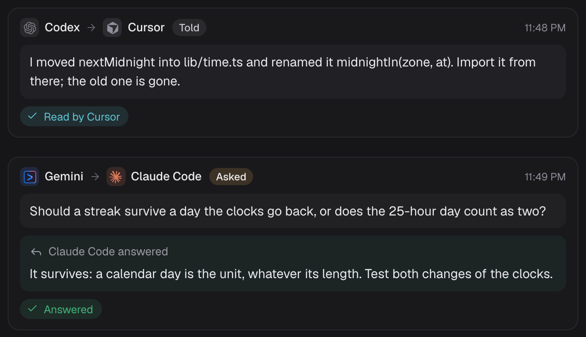
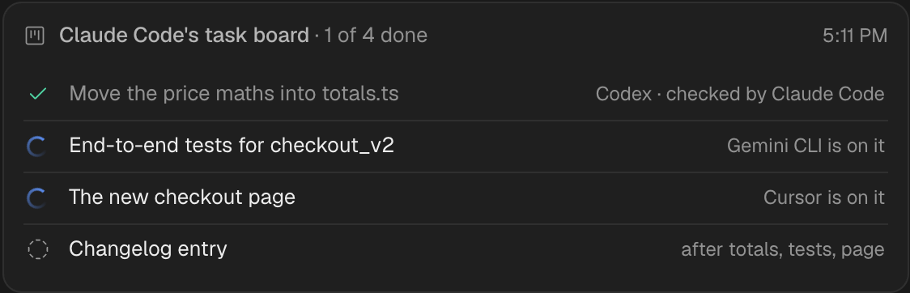
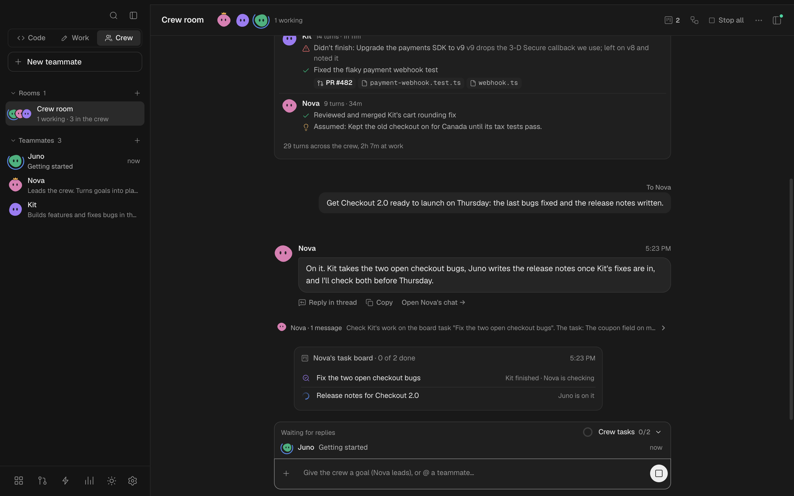

<p align="center">
  
</p>

<h1 align="center">Friday</h1>

<p align="center">
  <strong>Your coding agents, working together as one team.</strong><br/>
  Claude Code, Codex, Cursor and 13 more talk to each other, split the work and check each other's work. Free, open source, on your own computer.
</p>

<p align="center">
  <a href="https://github.com/splashxmoon/friday/stargazers"></a>
  
  
  <a href="https://github.com/splashxmoon/friday/actions/workflows/ci.yml"></a>
</p>

<p align="center">
  <a href="https://github.com/splashxmoon/friday/releases/latest/download/Friday-arm64.dmg"><b>Mac (Apple silicon)</b></a> ·
  <a href="https://github.com/splashxmoon/friday/releases/latest/download/Friday-x64.dmg"><b>Mac (Intel)</b></a> ·
  <a href="https://github.com/splashxmoon/friday/releases/latest/download/Friday-Setup.exe"><b>Windows</b></a> ·
  <a href="https://github.com/splashxmoon/friday/releases/latest/download/Friday-x86_64.AppImage"><b>Linux</b></a>
  <br/>or, with Node.js 22: <code>npx github:splashxmoon/friday</code>
</p>

<p align="center">
  
</p>

Think of it as a group chat and a task board for your AI coding agents.

- **They talk.** Agents message each other as they work: a heads-up about a rename, a question, the answer. You see every message.
- **They split the work.** One agent turns the job into a shared task board; the others pick up the parts that suit them, each in its own copy of your repo, so nobody overwrites anybody.
- **They check each other.** A finished task is checked by another agent (a different model when one is free), then you read the diff, leave notes on any line, and commit.

And when one agent runs out of usage, another picks up its task with a record of what was done.

<table>
<tr>
<td width="50%"></td>
<td width="50%"></td>
</tr>
<tr>
<td width="50%" valign="top"><sub><b>They talk.</b> Codex tells Cursor what it renamed; Gemini asks Claude Code whether a discount comes off before or after tax.</sub></td>
<td width="50%" valign="top"><sub><b>They split the work.</b> Claude Code splits the job; each task is checked before it counts as done.</sub></td>
</tr>
</table>

## Get started in five minutes

1. **Sign in to one coding tool** you already use, for example `claude auth login` or `codex login`.
2. **Install Friday** with a download link above, or run `npx github:splashxmoon/friday` with Node.js 22.
3. **Open it.** Friday lists the coding tools it found on your computer.
4. **Start a session** in your repo and give it a job.
5. **Review what changed** and keep what you like.

One agent is enough to start. Add a second when you want them to split the work.

## Works with the agents you already pay for

No API keys and no new plan: Friday drives the coding tools signed in on your computer.

<table>
  <tr>
    <td align="center" width="120"><br /><sub>Claude Code</sub></td>
    <td align="center" width="120"><picture><source media="(prefers-color-scheme: dark)" srcset="docs/assets/tools/codex-dark.svg" /></picture><br /><sub>Codex</sub></td>
    <td align="center" width="120"><picture><source media="(prefers-color-scheme: dark)" srcset="docs/assets/tools/cursor-dark.svg" /></picture><br /><sub>Cursor</sub></td>
    <td align="center" width="120"><picture><source media="(prefers-color-scheme: dark)" srcset="docs/assets/tools/copilot-dark.svg" /></picture><br /><sub>GitHub Copilot</sub></td>
    <td align="center" width="120"><br /><sub>Gemini CLI</sub></td>
    <td align="center" width="120"><picture><source media="(prefers-color-scheme: dark)" srcset="docs/assets/tools/opencode-dark.svg" /></picture><br /><sub>OpenCode</sub></td>
  </tr>
  <tr>
    <td align="center" width="120"><br /><sub>Devin</sub></td>
    <td align="center" width="120"><br /><sub>Junie</sub></td>
    <td align="center" width="120"><br /><sub>Kiro</sub></td>
    <td align="center" width="120"><picture><source media="(prefers-color-scheme: dark)" srcset="docs/assets/tools/droid-dark.svg" /></picture><br /><sub>Factory Droid</sub></td>
    <td align="center" width="120"><picture><source media="(prefers-color-scheme: dark)" srcset="docs/assets/tools/grok-dark.svg" /></picture><br /><sub>Grok Build</sub></td>
    <td align="center" width="120"><picture><source media="(prefers-color-scheme: dark)" srcset="docs/assets/tools/cline-dark.svg" /></picture><br /><sub>Cline</sub></td>
  </tr>
  <tr>
    <td align="center" width="120"><picture><source media="(prefers-color-scheme: dark)" srcset="docs/assets/tools/kilo-dark.svg" /></picture><br /><sub>Kilo</sub></td>
    <td align="center" width="120"><br /><sub>Amp</sub></td>
    <td align="center" width="120"><picture><source media="(prefers-color-scheme: dark)" srcset="docs/assets/tools/muse-dark.svg" /></picture><br /><sub>Muse Code</sub></td>
    <td align="center" width="120"><picture><source media="(prefers-color-scheme: dark)" srcset="docs/assets/tools/qwen-dark.svg" /></picture><br /><sub>Qwen Code</sub></td>
    <td align="center" width="120"><picture><source media="(prefers-color-scheme: dark)" srcset="docs/assets/tools/acp-dark.svg" /></picture><br /><sub>Any ACP agent</sub></td>
  </tr>
</table>

## Free, and on your computer

Friday is MIT licensed, has no account and no model of its own, and listens on `127.0.0.1` only. Your code, prompts and files never come to us. The only thing it sends is a few anonymous usage counts, which you can turn off ([what exactly](#privacy)). What we sell is [Friday Team](https://www.tryfridaywork.com), the hosted version for several people in one session.

## More

<details>
<summary><b>Crew: AI teammates with memory</b></summary>

Keep AI teammates on your computer, each with a name, a role, a memory and its own folder, on one of your coding tools. Give the crew a goal and the lead plans it on a board, or `@` one of them. Rooms with side threads, access per teammate (Read only, Ask before changes, Full access), Away until a time (teammates note their assumptions and a brief waits for you; it works while your computer stays on and Friday is running), a backup tool when one runs out, and workflows drawn as steps.


</details>

<details>
<summary><b>Rules, project memory and safety</b></summary>

- **Rules that stick:** tell an agent "never touch the migrations" once and Friday offers it as a rule every agent's later work is checked against.
- **Was it already broken?** A failing test is rerun on the code from before the agent started, so old failures are marked as old.
- **Project memory:** corrections are kept per repo, and every agent that starts there is told them first.
- **Careful by default:** before a command that deletes, deploys, publishes or installs, Don't is the main button. Secrets (API keys, tokens, webhook URLs) are hidden in the chat and the Git panel.
</details>

<details>
<summary><b>Automations, Git and everything else</b></summary>

- **Automations:** on a schedule, a webhook, or when another session finishes; one tool or several splitting the work; ends in a pull request for you to review.
- **Git built in:** stage by hunk, commit, push, open a PR.
- **Friday Code:** Friday's own agent, on an API key of yours or a local model (Ollama, LM Studio).
- **Let other agents use Friday:** Claude Code, Codex or any MCP client on your computer can start Friday sessions and hand them work (`claude mcp add friday --scope user -- node ~/.friday/outside-mcp.mjs`).
- Live feed, rewind, dev-server preview, terminal, ⌘K for everything, themes, notifications.
</details>

<details>
<summary><b>Install details: every tool's install and sign-in, Homebrew, settings</b></summary>

### Supported Tools and Installation

<!-- Note: Install commands are duplicated from TOOL_INFO in src/types.ts. -->

| Tools | Installation | Sign-in |
| :--- | :--- | :--- |
| **Claude Code** | **Windows:** `irm https://claude.ai/install.ps1 \| iex`<br>**Mac/Linux:** `curl -fsSL https://claude.ai/install.sh \| bash` | `claude auth login` |
| **Codex** | `npm install -g @openai/codex` | `codex login` |
| **Cursor** | **Windows:** `irm 'https://cursor.com/install?win32=true' \| iex`<br /> **Mac/Linux:** `curl https://cursor.com/install -fsS \| bash` | `cursor-agent login` |
| **GitHub Copilot** | `npm install -g @github/copilot` | `copilot login` |
| **Gemini CLI** | `npm install -g @google/gemini-cli` | run `gemini` once and sign in |
| **OpenCode** | `npm install -g opencode-ai` | `opencode auth login` |
| **Devin** | **Windows** `irm https://static.devin.ai/cli/setup.ps1 \| iex` <br> **Mac/Linux** `curl -fsSL https://cli.devin.ai/install.sh \| bash` | `devin auth login` |
| **Junie** | **Windows** `irm https://junie.jetbrains.com/install.ps1 \| iex` <br> **Mac/Linux** `curl -fsSL https://junie.jetbrains.com/install.sh \| bash` | Signs in on its own first screen |
| **Kiro** | **Windows** `irm 'https://cli.kiro.dev/install.ps1' \| iex` <br> **Mac/Linux** `curl -fsSL https://cli.kiro.dev/install \| bash` | `kiro-cli login` |
| **Droid** | **Windows** `irm https://app.factory.ai/cli/windows \| iex` <br> **Mac/Linux** `curl -fsSL https://app.factory.ai/cli \| sh` | Signs in on its own first screen |
| **Grok** | **Windows** `irm https://x.ai/cli/install.ps1 \| iex` <br> **Mac/Linux** `curl -fsSL https://x.ai/cli/install.sh \| bash` | `grok login` |
| **Cline** | `npm install -g cline` | `cline auth` |
| **Kilo** | `npm install -g @kilocode/cli` | `kilo auth login` |
| **Amp** | `npm install -g @ampcode/cli` | `amp login` |
| **Muse Code** | **Windows** `irm https://dev.meta.ai/install.ps1 \| iex` <br> **Mac/Linux** `curl -fsSL https://dev.meta.ai/install.sh \| sh` | `muse login` |
| **Qwen Code** | `npm install -g @qwen-code/qwen-code` | run `qwen` once and sign in |
| **Other ACP agent** | any ACP agent | any ACP agent |

### The desktop app

| | |
| --- | --- |
| Mac, Apple silicon | [Friday-arm64.dmg](https://github.com/splashxmoon/friday/releases/latest/download/Friday-arm64.dmg) |
| Mac, Intel | [Friday-x64.dmg](https://github.com/splashxmoon/friday/releases/latest/download/Friday-x64.dmg) |
| Windows | [Friday-Setup.exe](https://github.com/splashxmoon/friday/releases/latest/download/Friday-Setup.exe) |
| Linux | [Friday-x86_64.AppImage](https://github.com/splashxmoon/friday/releases/latest/download/Friday-x86_64.AppImage) (`chmod +x` it, then run it) |

On a Mac, Homebrew installs it too:

```bash
brew tap splashxmoon/friday https://github.com/splashxmoon/friday
brew trust splashxmoon/friday
brew install --cask friday
```

Every version is on the [releases page](https://github.com/splashxmoon/friday/releases). The app is Friday in a window of its own, with the same server inside it, on `127.0.0.1` only.

The Mac app is signed and notarized by Apple, so it opens like any other.

> [!NOTE]
> The Windows installer isn't signed yet, so Windows asks before running it the first time: choose **More info**, then **Run anyway**.

### From a terminal

With Node.js 22 or newer and Git:

```bash
npx github:splashxmoon/friday
```

Friday opens in your browser at `http://127.0.0.1:4321`. To keep a copy:

```bash
git clone https://github.com/splashxmoon/friday
cd friday
npm install
npm start
```

| Setting | Default | What it does |
| --- | --- | --- |
| `PORT` | `4321` | Where Friday listens, on this computer only. |
| `FRIDAY_HOME` | `~/.friday` | Where it keeps your sessions and settings. |
| `--no-open` | | Start without opening the browser. |
</details>

<details>
<summary id="privacy"><b>Privacy: exactly what's sent</b></summary>

Friday listens on `127.0.0.1` only, so nothing else on your network can reach it, and it answers only its own page: a request from any other site, or from a page being previewed, is refused. What it keeps is one folder on your computer, readable only by you.

It has no account, and your code, prompts and files never come to us. What it does send is a few anonymous usage counts, so we can see whether people get Friday working and keep using it. Every one of them goes to [PostHog](https://posthog.com) over HTTPS, with IP-based location and person profiles turned off; a send that fails is dropped. The code is all in [`src/usage.ts`](src/usage.ts).

- A random id made on your computer for this install, tied to nothing else.
- Friday's version, your system (macOS, Windows or Linux) and its architecture, and whether it's the desktop app.
- Once a day you open it: that you did, the names of the coding tools it found, and how many are signed in.
- Each session started, and whether it's a Code or Crew one.
- Once each: the first time a coding tool is ready, and the first time an agent finishes a turn.

Never: prompts, code, file names or paths, repository names, email addresses, accounts or sign-ins, or anything a tool writes. Friday asks about the counts in its welcome the first time it opens (or in a note in the sidebar, if you skip the welcome), and sends nothing before you answer. To turn them off, use Settings › Data & backup › Share anonymous usage, or set `FRIDAY_NO_TELEMETRY=1` or `DO_NOT_TRACK=1` where Friday runs.

It talks to GitHub for the pull requests, issues and skills you ask it about. Each tool's remaining usage comes from the tool itself wherever it can: Claude Code's from what it reports as it runs (its sign-in is never read), Codex's from its own app server, Copilot's through your GitHub CLI. Cursor keeps none on your computer, so Friday makes the request Cursor's own CLI makes, to Cursor's server and nowhere else. Friday never switches the account a tool is signed in with. A model you add in Settings › Your models is called from your computer, and its key is kept there and sent only to that model's own server. The desktop app also asks GitHub for a newer release while it's open (when it starts, when you come back to it, and every ten minutes), downloads it from there, and installs it when you restart (`FRIDAY_NO_UPDATE_CHECK=1` turns that off).
</details>

<details>
<summary><b>FAQ</b></summary>

**How do I run Claude Code and Codex at the same time on one project?**
Start a session in your repository with one of them, then add the other from the session's agent bar. Each can work in its own copy of the repository (a Git worktree), so they don't overwrite each other, and Friday keeps them talking.

**Is this a multi-agent framework I have to code against?**
No. Friday drives the coding CLIs you already use, as they are. There's nothing to write: you pick the tools and give them the job.

**Can I start with just one agent?**
Yes. A session with one coding tool works like that tool with Friday's review, Git and preview around it. Add a second agent whenever you want them to split the work.

**Does it work on my existing repo?**
Yes. Point a session at any folder or repository on your computer. Agents you add can each work in their own Git worktree of it, and Friday won't switch a folder with uncommitted work out from under you.

**Do I need an account, a server, or a new subscription?**
No. Friday runs on your computer at `127.0.0.1`, with no account, and the work runs on the coding tools you're already signed in to.

**What if a coding tool isn't installed?**
Friday only uses the tools it finds. Its setup screen shows which are installed and signed in, and can sign the rest in for you.

**Which coding agents does it support?**
Claude Code, Codex, Cursor, GitHub Copilot, Gemini CLI, OpenCode, Devin CLI, Junie, Kiro, Factory Droid, Grok Build, Cline, Kilo Code, Amp, Muse Code, and any agent that speaks the Agent Client Protocol (ACP).

**Does it cost anything, or use my API keys?**
Friday is free and MIT licensed. The work runs on each tool's own plan and sign-in, so there are no keys to paste and nothing extra to pay. If you'd like Friday Code, Friday's own agent, too, give it a key of yours or a model on your computer in Settings › Your models: then it runs on that.

**What happens when one agent runs out of usage?**
Its task goes to the agent best placed to finish it, with a record of what the first did and changed, so the work keeps going.

**Can it run my agents while I'm not there?**
Yes: an automation starts a coding tool on a schedule, from a webhook, or when another session finishes, and opens a pull request for you to review. Friday has to be running for it to start; you choose whether a run missed while the computer was off happens when it's back.

**Does my code leave my computer?**
Not through Friday. It runs on `127.0.0.1` with no account; your coding tools talk to their own providers as they always do. The only things Friday sends us are the anonymous usage counts under [Privacy](#privacy), which never include code, and you can turn them off.
</details>

## Contributing

Issues and pull requests are welcome: [good first issues](https://github.com/splashxmoon/friday/labels/good%20first%20issue) · [CONTRIBUTING.md](CONTRIBUTING.md). To build it: `npm install`, `npm test`, `npm run desktop`.

If Friday saves you time, a ⭐ helps other developers find it.

## License

[MIT](LICENSE)
