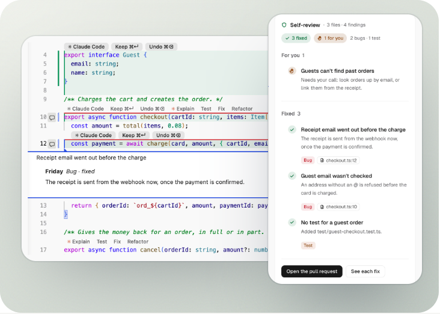

<p align="center">
  
</p>

<h1 align="center">Friday</h1>

<p align="center">
  <strong>Una sola app para todos tus agentes de programación.</strong><br/>
  Claude Code, Codex, Cursor y 19 más, con las suscripciones que ya pagas. Ejecútalos lado a lado o dales un trabajo: lo reparten, revisan el trabajo de los demás y uno continúa cuando otro se queda sin uso. Gratis y de código abierto, en tu propia computadora.
</p>

<p align="center"><sub><a href="../../README.md">English</a> · <a href="README.zh-CN.md">简体中文</a> · <a href="README.zh-TW.md">繁體中文</a> · <a href="README.ja.md">日本語</a> · <a href="README.ko.md">한국어</a> · <a href="README.vi.md">Tiếng Việt</a> · <b>Español</b> · <a href="README.pt-BR.md">Português</a> · <a href="README.fr.md">Français</a> · <a href="README.de.md">Deutsch</a> · <a href="README.ru.md">Русский</a></sub></p>

<p align="center"><sub>Traducido del README en inglés. Si no coinciden, el de inglés es el vigente.</sub></p>

<p align="center">
  <a href="https://github.com/splashxmoon/friday-code/stargazers"></a>
  
  
  <a href="https://github.com/splashxmoon/friday-code/actions/workflows/ci.yml"></a>
</p>

<p align="center">
  <a href="https://github.com/splashxmoon/friday-code/releases/latest/download/Friday-arm64.dmg"><b>Mac (Apple silicon)</b></a> ·
  <a href="https://github.com/splashxmoon/friday-code/releases/latest/download/Friday-x64.dmg"><b>Mac (Intel)</b></a> ·
  <a href="https://github.com/splashxmoon/friday-code/releases/latest/download/Friday-Setup.exe"><b>Windows</b></a> ·
  <a href="https://github.com/splashxmoon/friday-code/releases/latest/download/Friday-x86_64.AppImage"><b>Linux</b></a>
  <br/>o, con Node.js 22: <code>npx github:splashxmoon/friday-code</code>
</p>

<p align="center"><sub>Si Friday te ahorra tiempo, una ⭐ ayuda a que otras personas lo encuentren. ¿Quieres ayudar a construirlo? <a href="#contributing">Empieza aquí</a>.</sub></p>

<p align="center">
  
</p>

Piénsalo como un chat grupal y un tablero de tareas para tus agentes de programación con IA.

- **Hablan entre sí.** Los agentes se escriben mientras trabajan: un aviso sobre un cambio de nombre, una pregunta, la respuesta. Tú ves cada mensaje.
- **Reparten el trabajo.** Un agente convierte el trabajo en un tablero de tareas compartido; los demás toman las partes que mejor les quedan, cada uno en su propia copia de tu repo, así nadie pisa el trabajo de nadie.
- **Se revisan entre sí.** Otro agente revisa cada tarea terminada (con un modelo distinto cuando hay uno libre). Luego tú lees el diff, dejas notas en cualquier línea y haces commit.

Y cuando un agente se queda sin uso, otro toma su tarea con un registro de lo que ya se hizo.

<table>
<tr>
<td width="50%"></td>
<td width="50%"></td>
</tr>
<tr>
<td width="50%" valign="top"><sub><b>Hablan entre sí.</b> Un agente le pregunta a otro qué encontró y recibe la respuesta en el chat.</sub></td>
<td width="50%" valign="top"><sub><b>Reparten el trabajo.</b> Cada tarea, quién la tiene y en qué estado está, en un solo tablero.</sub></td>
</tr>
<tr>
<td width="50%"></td>
<td width="50%"></td>
</tr>
<tr>
<td width="50%" valign="top"><sub><b>Se revisan entre sí.</b> Un agente revisa el cambio y deja sus hallazgos en las líneas antes de que tú lo leas.</sub></td>
<td width="50%" valign="top"><sub><b>Cada uno en su propia copia.</b> Cada agente tiene su propio worktree y su propia rama, así nadie pisa el trabajo de nadie.</sub></td>
</tr>
</table>

### Friday IDE

Tu editor, tu terminal y tus extensiones, con el chat de cada agente al lado. Edita en el lugar con ⌘K, pon a competir dos o tres herramientas de programación con el mismo pedido y quédate con la mejor, y recibe una autorrevisión antes del pull request.

<p align="center">
  
</p>

## Empieza en cinco minutos

1. **Inicia sesión en una herramienta de programación** que ya uses, por ejemplo `claude auth login` o `codex login`.
2. **Instala Friday** con uno de los enlaces de descarga de arriba, o ejecuta `npx github:splashxmoon/friday-code` con Node.js 22.
3. **Ábrelo.** Friday muestra las herramientas de programación que encontró en tu computadora.
4. **Inicia una sesión** en tu repo y dale un trabajo.
5. **Revisa lo que cambió** y quédate con lo que te guste.

Con un agente alcanza para empezar. Agrega un segundo cuando quieras que se repartan el trabajo.

## Funciona con los agentes que ya pagas

Sin API keys y sin un plan nuevo: Friday usa las herramientas de programación con sesión iniciada en tu computadora.

<table>
  <tr>
    <td align="center" width="120"><br /><sub>Claude Code</sub></td>
    <td align="center" width="120"><br /><sub>Codex</sub></td>
    <td align="center" width="120"><br /><sub>Cursor</sub></td>
    <td align="center" width="120"><br /><sub>GitHub Copilot</sub></td>
    <td align="center" width="120"><br /><sub>Gemini CLI</sub></td>
    <td align="center" width="120"><br /><sub>Antigravity CLI</sub></td>
  </tr>
  <tr>
    <td align="center" width="120"><br /><sub>OpenCode</sub></td>
    <td align="center" width="120"><br /><sub>Devin</sub></td>
    <td align="center" width="120"><br /><sub>Junie</sub></td>
    <td align="center" width="120"><br /><sub>Kiro</sub></td>
    <td align="center" width="120"><br /><sub>Factory Droid</sub></td>
    <td align="center" width="120"><br /><sub>Grok Build</sub></td>
  </tr>
  <tr>
    <td align="center" width="120"><br /><sub>Cline</sub></td>
    <td align="center" width="120"><br /><sub>Kilo</sub></td>
    <td align="center" width="120"><br /><sub>Amp</sub></td>
    <td align="center" width="120"><br /><sub>Muse Code</sub></td>
    <td align="center" width="120"><br /><sub>Qwen Code</sub></td>
    <td align="center" width="120"><br /><sub>Pi</sub></td>
  </tr>
  <tr>
    <td align="center" width="120"><br /><sub>Goose</sub></td>
    <td align="center" width="120"><br /><sub>Auggie</sub></td>
    <td align="center" width="120"><br /><sub>Aider</sub></td>
    <td align="center" width="120"><br /><sub>Crush</sub></td>
    <td align="center" width="120"><br /><sub>Cualquier agente ACP</sub></td>
  </tr>
</table>

## Gratis y en tu computadora

Friday tiene licencia MIT, no tiene cuentas ni modelo propio, y escucha solo en `127.0.0.1`. Tu código, tus prompts y tus archivos nunca llegan a nosotros. Lo único que envía son unos pocos conteos de uso anónimos, que puedes desactivar ([qué exactamente](#privacy)). Lo que vendemos es [Friday Team](https://www.tryfridaywork.com), la versión alojada para varias personas en una misma sesión.

## Más

<details>
<summary><b>Crew: compañeros de IA con memoria</b></summary>

Ten compañeros de IA en tu computadora, cada uno con un nombre, un rol, una memoria y su propia carpeta, sobre una de tus herramientas de programación. Dale una meta al crew y el líder la planifica en un tablero, o menciona a uno con `@`. Salas con hilos laterales, permisos por compañero (Read only, Ask before changes, Full access), Away hasta una hora (los compañeros anotan sus supuestos y te espera un resumen; funciona mientras tu computadora siga encendida y Friday esté corriendo), una herramienta de respaldo cuando una se queda sin uso, y flujos de trabajo dibujados como pasos.


</details>

<details>
<summary><b>Reglas, memoria del proyecto y seguridad</b></summary>

- **Reglas que se mantienen:** dile a un agente "nunca toques las migraciones" una vez y Friday te ofrece guardarlo como regla contra la que se revisa el trabajo posterior de todos los agentes.
- **¿Ya estaba roto?** Un test que falla se vuelve a ejecutar sobre el código de antes de que el agente empezara, así las fallas viejas quedan marcadas como viejas.
- **Memoria del proyecto:** las correcciones se guardan por repo, y cada agente que empieza ahí las recibe primero.
- **Cuidadoso por defecto:** antes de un comando que borra, despliega, publica o instala, el botón principal es Don't. Los secretos (API keys, tokens, URLs de webhooks) se ocultan en el chat y en el panel de Git.
</details>

<details>
<summary><b>Automatizaciones, Git y todo lo demás</b></summary>

- **Automatizaciones:** según un horario, un webhook o cuando termina otra sesión; una herramienta o varias repartiéndose el trabajo; terminan en un pull request para que lo revises.
- **Git integrado:** stage por hunk, commit, push, abrir un PR.
- **Friday Code:** el agente propio de Friday, con una API key tuya o un modelo local (Ollama, LM Studio).
- **Deja que otros agentes usen Friday:** Claude Code, Codex o cualquier cliente MCP en tu computadora puede iniciar sesiones de Friday y pasarles trabajo (`claude mcp add friday --scope user -- node ~/.friday/outside-mcp.mjs`).
- Feed en vivo, rebobinar, vista previa del servidor de desarrollo, terminal, ⌘K para todo, temas, notificaciones.
</details>

<details>
<summary><b>Detalles de instalación: instalación e inicio de sesión de cada herramienta, Homebrew, configuración</b></summary>

### Herramientas compatibles e instalación

<!-- Note: Install commands are duplicated from TOOL_INFO in src/types.ts. -->

| Herramientas | Instalación | Inicio de sesión |
| :--- | :--- | :--- |
| **Claude Code** | **Windows:** `irm https://claude.ai/install.ps1 \| iex`<br>**Mac/Linux:** `curl -fsSL https://claude.ai/install.sh \| bash` | `claude auth login` |
| **Codex** | `npm install -g @openai/codex` | `codex login` |
| **Cursor** | **Windows:** `irm 'https://cursor.com/install?win32=true' \| iex`<br /> **Mac/Linux:** `curl https://cursor.com/install -fsS \| bash` | `cursor-agent login` |
| **GitHub Copilot** | `npm install -g @github/copilot` | `copilot login` |
| **Gemini CLI** | `npm install -g @google/gemini-cli` | ejecuta `gemini` una vez e inicia sesión |
| **Antigravity CLI** | **Windows:** `irm https://antigravity.google/cli/install.ps1 \| iex`<br>**Mac/Linux:** `curl -fsSL https://antigravity.google/cli/install.sh \| bash` | ejecuta `agy` una vez e inicia sesión |
| **OpenCode** | `npm install -g opencode-ai` | `opencode auth login` |
| **Devin** | **Windows** `irm https://static.devin.ai/cli/setup.ps1 \| iex` <br> **Mac/Linux** `curl -fsSL https://cli.devin.ai/install.sh \| bash` | `devin auth login` |
| **Junie** | **Windows** `irm https://junie.jetbrains.com/install.ps1 \| iex` <br> **Mac/Linux** `curl -fsSL https://junie.jetbrains.com/install.sh \| bash` | Inicia sesión en su propia primera pantalla |
| **Kiro** | **Windows** `irm 'https://cli.kiro.dev/install.ps1' \| iex` <br> **Mac/Linux** `curl -fsSL https://cli.kiro.dev/install \| bash` | `kiro-cli login` |
| **Droid** | **Windows** `irm https://app.factory.ai/cli/windows \| iex` <br> **Mac/Linux** `curl -fsSL https://app.factory.ai/cli \| sh` | Inicia sesión en su propia primera pantalla |
| **Grok** | **Windows** `irm https://x.ai/cli/install.ps1 \| iex` <br> **Mac/Linux** `curl -fsSL https://x.ai/cli/install.sh \| bash` | `grok login` |
| **Cline** | `npm install -g cline` | `cline auth` |
| **Kilo** | `npm install -g @kilocode/cli` | `kilo auth login` |
| **Amp** | `npm install -g @ampcode/cli` | `amp login` |
| **Muse Code** | **Windows** `irm https://dev.meta.ai/install.ps1 \| iex` <br> **Mac/Linux** `curl -fsSL https://dev.meta.ai/install.sh \| sh` | `muse login` |
| **Qwen Code** | `npm install -g @qwen-code/qwen-code` | ejecuta `qwen` una vez e inicia sesión |
| **Pi** | `npm install -g @mariozechner/pi-coding-agent` | ejecuta `pi` una vez y escribe `/login` (o configura la API key de un proveedor) |
| **Goose** | **Windows** `irm https://raw.githubusercontent.com/aaif-goose/goose/main/download_cli.ps1 \| iex` <br> **Mac/Linux** `curl -fsSL https://github.com/aaif-goose/goose/releases/download/stable/download_cli.sh \| bash` | ejecuta `goose configure` y elige un proveedor |
| **Auggie** | `npm install -g @augmentcode/auggie` | `auggie auth login` |
| **Aider** | **Windows** `powershell -ExecutionPolicy ByPass -c "irm https://aider.chat/install.ps1 \| iex"` <br> **Mac/Linux** `curl -LsSf https://aider.chat/install.sh \| sh` | configura la API key de un proveedor (p. ej., `ANTHROPIC_API_KEY`) |
| **Crush** | `npm install -g @charmland/crush` | `crush login` (o la API key de un proveedor) |
| **Otro agente ACP** | cualquier agente ACP | cualquier agente ACP |

### La app de escritorio

| | |
| --- | --- |
| Mac, Apple silicon | [Friday-arm64.dmg](https://github.com/splashxmoon/friday-code/releases/latest/download/Friday-arm64.dmg) |
| Mac, Intel | [Friday-x64.dmg](https://github.com/splashxmoon/friday-code/releases/latest/download/Friday-x64.dmg) |
| Windows | [Friday-Setup.exe](https://github.com/splashxmoon/friday-code/releases/latest/download/Friday-Setup.exe) |
| Linux | [Friday-x86_64.AppImage](https://github.com/splashxmoon/friday-code/releases/latest/download/Friday-x86_64.AppImage) (aplícale `chmod +x` y luego ejecútalo) |

En una Mac, también se instala con Homebrew:

```bash
brew tap splashxmoon/friday-code https://github.com/splashxmoon/friday-code
brew trust splashxmoon/friday-code
brew install --cask friday
```

Todas las versiones están en la [página de releases](https://github.com/splashxmoon/friday-code/releases). La app es Friday en su propia ventana, con el mismo servidor adentro, solo en `127.0.0.1`.

La app de Mac está firmada y notarizada por Apple, así que se abre como cualquier otra.

> [!NOTE]
> El instalador de Windows todavía no está firmado, así que Windows pregunta antes de ejecutarlo la primera vez: elige **Más información** y luego **Ejecutar de todas formas**.

### Desde una terminal

Con Node.js 22 o más reciente y Git:

```bash
npx github:splashxmoon/friday-code
```

Friday se abre en tu navegador en `http://127.0.0.1:4321`. Para tener una copia:

```bash
git clone https://github.com/splashxmoon/friday-code
cd friday-code
npm install
npm start
```

| Configuración | Valor por defecto | Qué hace |
| --- | --- | --- |
| `PORT` | `4321` | Dónde escucha Friday, solo en esta computadora. |
| `FRIDAY_HOME` | `~/.friday` | Dónde guarda tus sesiones y tu configuración. |
| `--no-open` | | Inicia sin abrir el navegador. |
</details>

<details>
<summary id="privacy"><b>Privacidad: exactamente qué se envía</b></summary>

Friday escucha solo en `127.0.0.1`, así que nada más en tu red puede alcanzarlo, y solo responde a su propia página: se rechaza cualquier pedido que venga de otro sitio o de una página en vista previa. Lo que guarda es una carpeta en tu computadora que solo tú puedes leer.

No tiene cuentas, y tu código, tus prompts y tus archivos nunca llegan a nosotros. Lo que sí envía son unos pocos conteos de uso anónimos, para que podamos ver si la gente logra hacer funcionar Friday y lo sigue usando. Todos van a [PostHog](https://posthog.com) por HTTPS, con la ubicación por IP y los perfiles de persona desactivados; si un envío falla, se descarta. Todo el código está en [`src/usage.ts`](../../src/usage.ts).

- Un id aleatorio generado en tu computadora para esta instalación, sin relación con nada más.
- La versión de Friday, tu sistema (macOS, Windows o Linux) y su arquitectura, y si es la app de escritorio.
- Una vez por día que lo abres: que lo abriste, los nombres de las herramientas de programación que encontró y cuántas tienen sesión iniciada.
- Cada sesión iniciada, y si es de tipo Code o Crew.
- Una sola vez cada una: la primera vez que una herramienta de programación está lista, y la primera vez que un agente termina un turno.

Nunca: prompts, código, nombres o rutas de archivos, nombres de repositorios, direcciones de email, cuentas o inicios de sesión, ni nada que escriba una herramienta. Friday te pregunta por los conteos en su bienvenida la primera vez que se abre (o en una nota en la barra lateral, si saltas la bienvenida), y no envía nada antes de que respondas. Para desactivarlos, usa Settings › Data & backup › Share anonymous usage, o define `FRIDAY_NO_TELEMETRY=1` o `DO_NOT_TRACK=1` donde corre Friday.

Se comunica con GitHub para los pull requests, issues y skills sobre los que le preguntes. El uso restante de cada herramienta se obtiene de la propia herramienta siempre que se puede: el de Claude Code, de lo que informa mientras corre (su inicio de sesión nunca se lee); el de Codex, de su propio app server; el de Copilot, a través de tu GitHub CLI. Cursor no guarda nada en tu computadora, así que Friday hace el mismo pedido que hace la propia CLI de Cursor, al servidor de Cursor y a ningún otro lado. Para las demás herramientas que guardan un inicio de sesión en tu computadora (Kilo, OpenCode, Grok, Factory Droid, Antigravity, Cline, Amp y algunas más), Friday lo lee ahí solo para preguntarle al servidor de esa herramienta cuánto uso te queda. No va a ningún otro lado, nunca a nosotros, y nunca entra en los conteos de uso. Friday nunca cambia la cuenta con la que una herramienta tiene sesión iniciada. Un modelo que agregas en Settings › Your models se llama desde tu computadora, y su key se guarda ahí y se envía solo al servidor de ese modelo. La app de escritorio también le pregunta a GitHub si hay una versión más nueva mientras está abierta (al iniciar, cuando vuelves a ella y cada diez minutos), la descarga desde ahí y la instala cuando reinicias (`FRIDAY_NO_UPDATE_CHECK=1` desactiva eso).

</details>

<details>
<summary><b>Preguntas frecuentes</b></summary>

**¿Cómo ejecuto Claude Code y Codex al mismo tiempo en un proyecto?**
Inicia una sesión en tu repositorio con uno de ellos y luego agrega el otro desde la barra de agentes de la sesión. Cada uno puede trabajar en su propia copia del repositorio (un Git worktree), así no se pisan, y Friday los mantiene en contacto.

**¿Es un framework multiagente contra el que tengo que programar?**
No. Friday usa las CLIs de programación que ya usas, tal como son. No hay nada que escribir: eliges las herramientas y les das el trabajo.

**¿Puedo empezar con un solo agente?**
Sí. Una sesión con una sola herramienta de programación funciona como esa herramienta, con la revisión, Git y la vista previa de Friday alrededor. Agrega un segundo agente cuando quieras que se repartan el trabajo.

**¿Funciona con mi repo existente?**
Sí. Apunta una sesión a cualquier carpeta o repositorio de tu computadora. Cada agente que agregues puede trabajar en su propio Git worktree, y Friday no te va a cambiar una carpeta con trabajo sin commit sin que te des cuenta.

**¿Necesito una cuenta, un servidor o una suscripción nueva?**
No. Friday corre en tu computadora en `127.0.0.1`, sin cuenta, y el trabajo corre en las herramientas de programación en las que ya tienes sesión iniciada.

**¿Y si una herramienta de programación no está instalada?**
Friday solo usa las herramientas que encuentra. Su pantalla de configuración muestra cuáles están instaladas y con sesión iniciada, y puede iniciar sesión en las demás por ti.

**¿Qué agentes de programación soporta?**
Claude Code, Codex, Cursor, GitHub Copilot, Gemini CLI, Antigravity CLI, OpenCode, Devin CLI, Junie, Kiro, Factory Droid, Grok Build, Cline, Kilo Code, Amp, Muse Code y cualquier agente que hable el Agent Client Protocol (ACP).

**¿Cuesta algo, o usa mis API keys?**
Friday es gratis y tiene licencia MIT. El trabajo corre con el plan y el inicio de sesión de cada herramienta, así que no hay keys que pegar ni nada extra que pagar. Si también quieres Friday Code, el agente propio de Friday, dale una key tuya o un modelo en tu computadora en Settings › Your models: entonces corre con eso.

**¿Qué pasa cuando un agente se queda sin uso?**
Su tarea pasa al agente mejor ubicado para terminarla, con un registro de lo que hizo y cambió el primero, así el trabajo sigue.

**¿Puede ejecutar mis agentes cuando no estoy?**
Sí: una automatización inicia una herramienta de programación según un horario, desde un webhook o cuando termina otra sesión, y abre un pull request para que lo revises. Friday tiene que estar corriendo para que empiece; tú eliges si una ejecución que se perdió con la computadora apagada se hace cuando vuelve a encenderse.

**¿Mi código sale de mi computadora?**
No a través de Friday. Corre en `127.0.0.1` sin cuenta; tus herramientas de programación hablan con sus propios proveedores como siempre. Lo único que Friday nos envía son los conteos de uso anónimos descritos en [Privacidad](#privacy), que nunca incluyen código, y puedes desactivarlos.
</details>

<a id="contributing"></a>
## Contribuir

Friday se construye en abierto y cada pull request recibe respuesta en menos de un día. Buenos lugares para empezar:

- **Agrega una herramienta de programación.** La mayoría de las herramientas son un adaptador corto, y [la guía](../../docs/adding-a-coding-tool.md) explica cómo hacer uno paso a paso.
- **Empaquétalo.** [Scoop](https://github.com/splashxmoon/friday-code/issues/41) para Windows, [el AUR](https://github.com/splashxmoon/friday-code/issues/40) para Arch.
- **Pruébalo y cuéntanos.** [El AppImage de Linux en tu distro](https://github.com/splashxmoon/friday-code/issues/4), [inicio de sesión MCP en Windows y Linux](https://github.com/splashxmoon/friday-code/issues/26).
- **¿Otra cosa?** [Empieza aquí](https://github.com/splashxmoon/friday-code/issues/42), los [good first issues](https://github.com/splashxmoon/friday-code/labels/good%20first%20issue), o una idea en [Discussions](https://github.com/splashxmoon/friday-code/discussions).

Para compilarlo: `npm install`, `npm start` (o `npm run desktop`), `npm test`. [CONTRIBUTING.md](../../CONTRIBUTING.md) tiene el resto. Cada nota de release agradece a las personas cuyo trabajo está incluido.

Gracias a todas las personas que ayudaron a construir Friday:

<a href="https://github.com/splashxmoon/friday-code/graphs/contributors"></a>

Si Friday te ahorra tiempo, una ⭐ ayuda a que otros desarrolladores lo encuentren.

## Licencia

[MIT](../../LICENSE)
