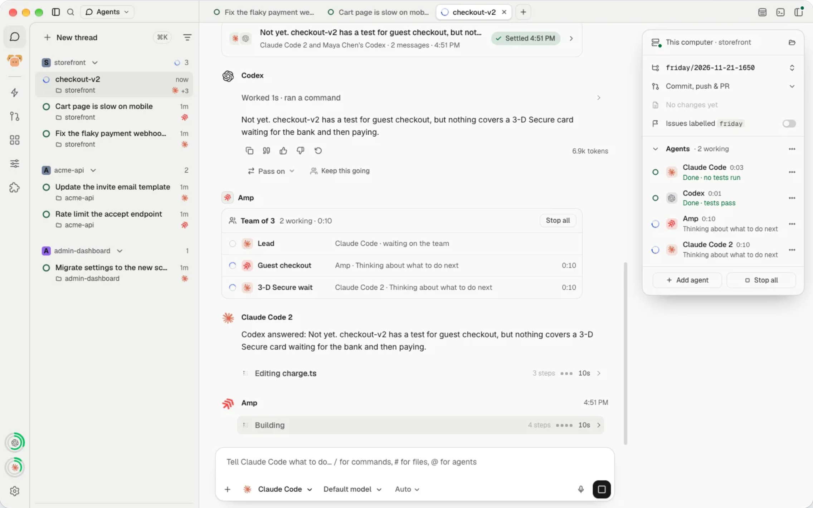
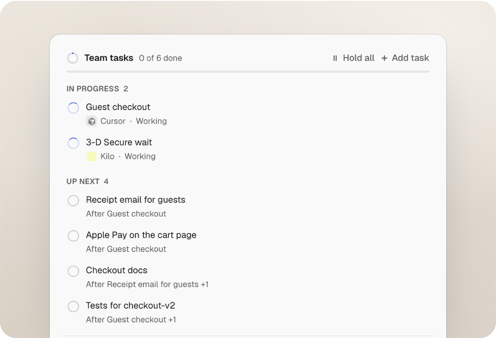

<p align="center">
  
</p>

<h1 align="center">Friday</h1>

<p align="center">
  <strong>모든 코딩 에이전트를 하나의 앱에서.</strong><br/>
  Claude Code, Codex, Cursor 외 15종을 이미 결제 중인 구독 그대로 씁니다. 나란히 함께 돌리거나, 일을 통째로 맡길 수 있습니다. 맡기면 에이전트끼리 일을 나누고, 서로의 작업을 리뷰하고, 하나가 사용량이 떨어지면 다른 에이전트가 이어받습니다. 무료 오픈소스이며 내 컴퓨터에서 돌아갑니다.
</p>

<p align="center"><sub><a href="../../README.md">English</a> · <a href="README.zh-CN.md">简体中文</a> · <a href="README.zh-TW.md">繁體中文</a> · <a href="README.ja.md">日本語</a> · <b>한국어</b> · <a href="README.vi.md">Tiếng Việt</a> · <a href="README.es.md">Español</a> · <a href="README.pt-BR.md">Português</a> · <a href="README.fr.md">Français</a> · <a href="README.de.md">Deutsch</a> · <a href="README.ru.md">Русский</a></sub></p>
<p align="center"><sub>영어 README를 번역한 문서입니다. 내용이 다르면 영어판이 최신입니다.</sub></p>

<p align="center">
  <a href="https://github.com/splashxmoon/friday-code/stargazers"></a>
  
  
  <a href="https://github.com/splashxmoon/friday-code/actions/workflows/ci.yml"></a>
</p>

<p align="center">
  <a href="https://github.com/splashxmoon/friday-code/releases/latest/download/Friday-arm64.dmg"><b>Mac (Apple 실리콘)</b></a> ·
  <a href="https://github.com/splashxmoon/friday-code/releases/latest/download/Friday-x64.dmg"><b>Mac (Intel)</b></a> ·
  <a href="https://github.com/splashxmoon/friday-code/releases/latest/download/Friday-Setup.exe"><b>Windows</b></a> ·
  <a href="https://github.com/splashxmoon/friday-code/releases/latest/download/Friday-x86_64.AppImage"><b>Linux</b></a>
  <br/>또는 Node.js 22에서: <code>npx github:splashxmoon/friday-code</code>
</p>

<p align="center"><sub>Friday로 시간을 아꼈다면 ⭐ 하나가 다른 사람들이 Friday를 찾는 데 도움이 됩니다. 개발에 함께하고 싶다면 <a href="#contributing">여기서 시작하세요</a>.</sub></p>

<p align="center">
  
</p>

AI 코딩 에이전트를 위한 그룹 채팅이자 작업 보드라고 생각하면 됩니다.

- **서로 대화합니다.** 에이전트는 일하면서 서로 메시지를 주고받습니다. 이름 변경 예고, 질문, 그리고 답. 모든 메시지를 내가 볼 수 있습니다.
- **일을 나눕니다.** 한 에이전트가 일을 공유 작업 보드로 쪼개면, 다른 에이전트들이 자기에게 맞는 부분을 가져갑니다. 각자 저장소의 자기 사본에서 작업하므로 서로의 작업을 덮어쓰지 않습니다.
- **서로 검토합니다.** 끝난 작업은 다른 에이전트가 검토합니다(여유가 있으면 다른 모델로). 그다음 내가 diff를 읽고, 원하는 줄에 메모를 남기고, 커밋합니다.

그리고 한 에이전트의 사용량이 떨어지면, 지금까지 한 일의 기록과 함께 다른 에이전트가 그 작업을 이어받습니다.

<table>
<tr>
<td width="50%"></td>
<td width="50%"></td>
</tr>
<tr>
<td width="50%" valign="top"><sub><b>서로 대화합니다.</b> 한 에이전트가 다른 에이전트에게 무엇을 찾았는지 묻고, 답을 채팅으로 받습니다.</sub></td>
<td width="50%" valign="top"><sub><b>일을 나눕니다.</b> 모든 작업과 담당자, 진행 상황을 하나의 보드에서.</sub></td>
</tr>
<tr>
<td width="50%"></td>
<td width="50%"></td>
</tr>
<tr>
<td width="50%" valign="top"><sub><b>서로 검토합니다.</b> 내가 읽기 전에 에이전트가 변경 사항을 리뷰하고 발견한 내용을 해당 줄에 남깁니다.</sub></td>
<td width="50%" valign="top"><sub><b>각자 자기 사본에서.</b> 에이전트마다 전용 worktree와 브랜치가 있어서 서로의 작업을 덮어쓰지 않습니다.</sub></td>
</tr>
</table>

### Friday IDE

평소 쓰던 에디터, 터미널, 확장 기능 옆에 모든 에이전트의 채팅이 함께 있습니다. ⌘K로 그 자리에서 고치고, 하나의 요청을 코딩 도구 두세 개에 경쟁시켜 가장 좋은 결과를 남기고, 풀 리퀘스트 전에 셀프 리뷰를 받을 수 있습니다.

<p align="center">
  
</p>

## 5분 만에 시작하기

1. **이미 쓰는 코딩 도구 하나에 로그인합니다.** 예: `claude auth login` 또는 `codex login`.
2. **Friday를 설치합니다.** 위의 다운로드 링크를 쓰거나, Node.js 22에서 `npx github:splashxmoon/friday-code`를 실행합니다.
3. **실행합니다.** Friday가 내 컴퓨터에서 찾은 코딩 도구 목록을 보여 줍니다.
4. **세션을 시작합니다.** 저장소에서 세션을 열고 일을 맡깁니다.
5. **바뀐 내용을 검토합니다.** 마음에 드는 것만 남깁니다.

처음에는 에이전트 하나면 충분합니다. 일을 나누고 싶을 때 두 번째를 추가하세요.

## 이미 결제 중인 에이전트로 동작합니다

API 키도, 새 요금제도 필요 없습니다. Friday는 내 컴퓨터에 로그인된 코딩 도구를 그대로 움직입니다.

<table>
  <tr>
    <td align="center" width="120"><br /><sub>Claude Code</sub></td>
    <td align="center" width="120"><br /><sub>Codex</sub></td>
    <td align="center" width="120"><br /><sub>Cursor</sub></td>
    <td align="center" width="120"><br /><sub>GitHub Copilot</sub></td>
    <td align="center" width="120"><br /><sub>Gemini CLI</sub></td>
    <td align="center" width="120"><br /><sub>Antigravity CLI</sub></td>
  </tr>
  <tr>
    <td align="center" width="120"><br /><sub>OpenCode</sub></td>
    <td align="center" width="120"><br /><sub>Devin</sub></td>
    <td align="center" width="120"><br /><sub>Junie</sub></td>
    <td align="center" width="120"><br /><sub>Kiro</sub></td>
    <td align="center" width="120"><br /><sub>Factory Droid</sub></td>
    <td align="center" width="120"><br /><sub>Grok Build</sub></td>
  </tr>
  <tr>
    <td align="center" width="120"><br /><sub>Cline</sub></td>
    <td align="center" width="120"><br /><sub>Kilo</sub></td>
    <td align="center" width="120"><br /><sub>Amp</sub></td>
    <td align="center" width="120"><br /><sub>Muse Code</sub></td>
    <td align="center" width="120"><br /><sub>Qwen Code</sub></td>
    <td align="center" width="120"><br /><sub>Pi</sub></td>
  </tr>
  <tr>
    <td align="center" width="120"><br /><sub>모든 ACP 에이전트</sub></td>
  </tr>
</table>

## 무료, 그리고 내 컴퓨터에서

Friday는 MIT 라이선스입니다. 계정도 자체 모델도 없고, `127.0.0.1`에서만 연결을 받습니다. 내 코드, 프롬프트, 파일은 절대 우리에게 오지 않습니다. 보내는 것은 몇 가지 익명 사용 집계뿐이며, 이것도 끌 수 있습니다([정확히 무엇을 보내는지](#privacy)). 우리가 판매하는 것은 [Friday Team](https://www.tryfridaywork.com)으로, 여러 사람이 하나의 세션을 함께 쓰는 호스팅 버전입니다.

## 더 보기

<details>
<summary><b>Crew: 기억을 가진 AI 팀원</b></summary>

내 컴퓨터에 AI 팀원을 둘 수 있습니다. 팀원마다 이름, 역할, 기억, 전용 폴더가 있고, 내 코딩 도구 중 하나로 동작합니다. Crew에 목표를 주면 리더가 보드에 계획을 세우고, `@`로 한 명을 직접 부를 수도 있습니다. 사이드 스레드가 있는 룸, 팀원별 권한(Read only, Ask before changes, Full access), 정한 시각까지의 Away(팀원들이 자기 가정을 기록해 두고, 나를 위한 요약이 기다립니다. 컴퓨터가 켜져 있고 Friday가 실행 중인 동안 동작합니다), 도구 하나의 사용량이 떨어졌을 때 쓸 예비 도구, 단계로 그리는 워크플로가 있습니다.


</details>

<details>
<summary><b>규칙, 프로젝트 기억, 안전</b></summary>

- **계속 남는 규칙:** 에이전트에게 "migrations는 절대 건드리지 마"라고 한 번 말하면, Friday가 그것을 규칙으로 제안합니다. 이후 모든 에이전트의 작업은 이 규칙에 비추어 검사됩니다.
- **원래 깨져 있었나?** 실패한 테스트는 에이전트가 시작하기 전의 코드로 다시 실행되므로, 예전부터 있던 실패는 예전 실패로 표시됩니다.
- **프로젝트 기억:** 정정한 내용은 저장소별로 보관되고, 그 저장소에서 시작하는 모든 에이전트에게 가장 먼저 전달됩니다.
- **기본은 신중하게:** 삭제, 배포, 게시, 설치를 하는 명령 앞에서는 Don't가 기본 버튼입니다. 시크릿(API 키, 토큰, webhook URL)은 채팅과 Git 패널에서 가려집니다.
</details>

<details>
<summary><b>Automations, Git, 그 밖의 모든 것</b></summary>

- **Automations:** 일정에 따라, webhook으로, 또는 다른 세션이 끝났을 때 실행됩니다. 도구 하나로 돌려도 되고 여러 도구가 일을 나눠도 됩니다. 마지막에는 내가 검토할 풀 리퀘스트가 만들어집니다.
- **Git 내장:** hunk 단위 스테이징, 커밋, 푸시, PR 열기.
- **Friday Code:** Friday 자체 에이전트로, 내 API 키나 로컬 모델(Ollama, LM Studio)로 동작합니다.
- **다른 에이전트가 Friday를 쓰게 하기:** 내 컴퓨터의 Claude Code, Codex 또는 아무 MCP 클라이언트나 Friday 세션을 시작하고 일을 넘길 수 있습니다(`claude mcp add friday --scope user -- node ~/.friday/outside-mcp.mjs`).
- 라이브 피드, 되감기, 개발 서버 미리보기, 터미널, 무엇이든 ⌘K, 테마, 알림.
</details>

<details>
<summary><b>설치 상세: 도구별 설치와 로그인, Homebrew, 설정</b></summary>

### 지원 도구와 설치

<!-- Note: Install commands are duplicated from TOOL_INFO in src/types.ts. -->

| 도구 | 설치 | 로그인 |
| :--- | :--- | :--- |
| **Claude Code** | **Windows:** `irm https://claude.ai/install.ps1 \| iex`<br>**Mac/Linux:** `curl -fsSL https://claude.ai/install.sh \| bash` | `claude auth login` |
| **Codex** | `npm install -g @openai/codex` | `codex login` |
| **Cursor** | **Windows:** `irm 'https://cursor.com/install?win32=true' \| iex`<br /> **Mac/Linux:** `curl https://cursor.com/install -fsS \| bash` | `cursor-agent login` |
| **GitHub Copilot** | `npm install -g @github/copilot` | `copilot login` |
| **Gemini CLI** | `npm install -g @google/gemini-cli` | `gemini`을 한 번 실행해 로그인 |
| **Antigravity CLI** | **Windows:** `irm https://antigravity.google/cli/install.ps1 \| iex`<br>**Mac/Linux:** `curl -fsSL https://antigravity.google/cli/install.sh \| bash` | `agy`를 한 번 실행해 로그인 |
| **OpenCode** | `npm install -g opencode-ai` | `opencode auth login` |
| **Devin** | **Windows** `irm https://static.devin.ai/cli/setup.ps1 \| iex` <br> **Mac/Linux** `curl -fsSL https://cli.devin.ai/install.sh \| bash` | `devin auth login` |
| **Junie** | **Windows** `irm https://junie.jetbrains.com/install.ps1 \| iex` <br> **Mac/Linux** `curl -fsSL https://junie.jetbrains.com/install.sh \| bash` | 도구의 첫 화면에서 직접 로그인 |
| **Kiro** | **Windows** `irm 'https://cli.kiro.dev/install.ps1' \| iex` <br> **Mac/Linux** `curl -fsSL https://cli.kiro.dev/install \| bash` | `kiro-cli login` |
| **Droid** | **Windows** `irm https://app.factory.ai/cli/windows \| iex` <br> **Mac/Linux** `curl -fsSL https://app.factory.ai/cli \| sh` | 도구의 첫 화면에서 직접 로그인 |
| **Grok** | **Windows** `irm https://x.ai/cli/install.ps1 \| iex` <br> **Mac/Linux** `curl -fsSL https://x.ai/cli/install.sh \| bash` | `grok login` |
| **Cline** | `npm install -g cline` | `cline auth` |
| **Kilo** | `npm install -g @kilocode/cli` | `kilo auth login` |
| **Amp** | `npm install -g @ampcode/cli` | `amp login` |
| **Muse Code** | **Windows** `irm https://dev.meta.ai/install.ps1 \| iex` <br> **Mac/Linux** `curl -fsSL https://dev.meta.ai/install.sh \| sh` | `muse login` |
| **Qwen Code** | `npm install -g @qwen-code/qwen-code` | `qwen`을 한 번 실행해 로그인 |
| **Pi** | `npm install -g @mariozechner/pi-coding-agent` | `pi`를 한 번 실행하고 `/login` 입력(또는 프로바이더의 API 키 설정) |
| **그 밖의 ACP 에이전트** | 모든 ACP 에이전트 | 모든 ACP 에이전트 |

### 데스크톱 앱

| | |
| --- | --- |
| Mac, Apple 실리콘 | [Friday-arm64.dmg](https://github.com/splashxmoon/friday-code/releases/latest/download/Friday-arm64.dmg) |
| Mac, Intel | [Friday-x64.dmg](https://github.com/splashxmoon/friday-code/releases/latest/download/Friday-x64.dmg) |
| Windows | [Friday-Setup.exe](https://github.com/splashxmoon/friday-code/releases/latest/download/Friday-Setup.exe) |
| Linux | [Friday-x86_64.AppImage](https://github.com/splashxmoon/friday-code/releases/latest/download/Friday-x86_64.AppImage) (`chmod +x`로 권한을 준 다음 실행) |

Mac에서는 Homebrew로도 설치할 수 있습니다:

```bash
brew tap splashxmoon/friday-code https://github.com/splashxmoon/friday-code
brew trust splashxmoon/friday-code
brew install --cask friday
```

모든 버전은 [릴리스 페이지](https://github.com/splashxmoon/friday-code/releases)에 있습니다. 앱은 Friday를 전용 창에 띄운 것이고, 안에서는 같은 서버가 `127.0.0.1`에서만 돌아갑니다.

Mac 앱은 Apple의 서명과 공증을 받았으므로 다른 앱처럼 바로 열립니다.

> [!NOTE]
> Windows 설치 프로그램은 아직 서명되지 않아서, 처음 실행할 때 Windows가 확인을 요청합니다. **추가 정보**(More info)를 누른 다음 **실행**(Run anyway)을 누르세요.

### 터미널에서

Node.js 22 이상과 Git이 있으면:

```bash
npx github:splashxmoon/friday-code
```

Friday가 브라우저에서 `http://127.0.0.1:4321`로 열립니다. 사본을 내려받아 두려면:

```bash
git clone https://github.com/splashxmoon/friday-code
cd friday-code
npm install
npm start
```

| 설정 | 기본값 | 하는 일 |
| --- | --- | --- |
| `PORT` | `4321` | Friday가 연결을 받는 포트. 이 컴퓨터에서만 접근할 수 있습니다. |
| `FRIDAY_HOME` | `~/.friday` | 세션과 설정을 저장하는 위치. |
| `--no-open` | | 브라우저를 열지 않고 시작합니다. |
</details>

<details>
<summary id="privacy"><b>개인정보: 정확히 무엇을 보내는지</b></summary>

Friday는 `127.0.0.1`에서만 연결을 받으므로 같은 네트워크의 다른 기기는 접근할 수 없고, 자기 페이지에만 응답합니다. 다른 사이트나 미리보기 중인 페이지에서 온 요청은 거부됩니다. 저장하는 것은 내 컴퓨터의 폴더 하나뿐이며, 나만 읽을 수 있습니다.

계정이 없고, 내 코드, 프롬프트, 파일은 절대 우리에게 오지 않습니다. 보내는 것은 몇 가지 익명 사용 집계뿐이며, 사람들이 Friday를 제대로 실행하고 계속 쓰는지 알기 위한 것입니다. 모두 HTTPS로 [PostHog](https://posthog.com)에 전송되고, IP 기반 위치와 개인 프로필 기능은 꺼져 있습니다. 전송에 실패하면 그대로 버립니다. 관련 코드는 모두 [`src/usage.ts`](../../src/usage.ts)에 있습니다.

- 이 설치를 위해 내 컴퓨터에서 만든 무작위 ID. 다른 어떤 것과도 연결되지 않습니다.
- Friday 버전, 시스템(macOS, Windows, Linux)과 아키텍처, 데스크톱 앱인지 여부.
- 앱을 연 날마다 한 번: 열었다는 사실, 찾은 코딩 도구 이름, 그중 로그인된 도구 수.
- 시작한 세션마다, 그것이 Code 세션인지 Crew 세션인지.
- 각각 한 번씩: 코딩 도구가 처음 준비됐을 때, 에이전트가 처음으로 턴을 마쳤을 때.

절대 보내지 않는 것: 프롬프트, 코드, 파일 이름이나 경로, 저장소 이름, 이메일 주소, 계정이나 로그인 정보, 도구가 작성하는 모든 내용. Friday는 처음 열릴 때 환영 화면에서(환영 화면을 건너뛰면 사이드바의 안내에서) 집계에 대해 묻고, 답하기 전에는 아무것도 보내지 않습니다. 끄려면 Settings › Data & backup › Share anonymous usage를 사용하거나, Friday가 실행되는 환경에 `FRIDAY_NO_TELEMETRY=1` 또는 `DO_NOT_TRACK=1`을 설정하세요.

내가 물어본 풀 리퀘스트, 이슈, 스킬 때문에 GitHub와 통신합니다. 각 도구의 남은 사용량은 가능한 한 그 도구 자신에게서 가져옵니다. Claude Code는 실행 중에 보고하는 내용에서(로그인 정보는 절대 읽지 않습니다), Codex는 자체 앱 서버에서, Copilot은 내 GitHub CLI를 통해 가져옵니다. Cursor는 내 컴퓨터에 아무것도 저장하지 않으므로, Friday는 Cursor 자체 CLI가 보내는 것과 같은 요청을 Cursor 서버로만 보냅니다. 로그인 정보를 내 컴퓨터에 저장하는 그 밖의 도구(Kilo, OpenCode, Grok, Factory Droid, Antigravity, Cline, Amp 등)는, 그 도구 자체 서버에 남은 사용량을 묻기 위해서만 Friday가 그 자리에서 읽습니다. 그 정보는 다른 곳으로 가지 않고, 우리에게도 오지 않으며, 사용 집계에도 들어가지 않습니다. Friday는 도구에 로그인된 계정을 절대 바꾸지 않습니다. Settings › Your models에서 추가한 모델은 내 컴퓨터에서 호출되고, 그 키도 내 컴퓨터에 보관되며 그 모델 자체 서버로만 전송됩니다. 데스크톱 앱은 열려 있는 동안 GitHub에 새 릴리스가 있는지도 확인하고(시작할 때, 앱으로 돌아올 때, 10분마다), 거기서 내려받아 재시작할 때 설치합니다(`FRIDAY_NO_UPDATE_CHECK=1`로 끌 수 있습니다).

</details>

<details>
<summary><b>자주 묻는 질문</b></summary>

**한 프로젝트에서 Claude Code와 Codex를 동시에 돌리려면 어떻게 하나요?**
저장소에서 둘 중 하나로 세션을 시작한 다음, 세션의 에이전트 바에서 다른 하나를 추가하세요. 각자 저장소의 자기 사본(Git worktree)에서 작업할 수 있어 서로 덮어쓰지 않고, Friday가 둘이 계속 대화하게 해 줍니다.

**직접 코드를 짜서 써야 하는 멀티 에이전트 프레임워크인가요?**
아니요. Friday는 이미 쓰고 있는 코딩 CLI를 있는 그대로 움직입니다. 작성할 것은 없습니다. 도구를 고르고 일을 맡기면 됩니다.

**에이전트 하나로 시작해도 되나요?**
네. 코딩 도구 하나로 연 세션은 그 도구에 Friday의 리뷰, Git, 미리보기가 더해진 것처럼 동작합니다. 일을 나누고 싶을 때 언제든 두 번째 에이전트를 추가하세요.

**기존 저장소에서도 쓸 수 있나요?**
네. 내 컴퓨터의 어떤 폴더나 저장소든 세션으로 지정할 수 있습니다. 추가한 에이전트는 각자 그 저장소의 Git worktree에서 작업할 수 있고, 커밋하지 않은 작업이 있는 폴더를 Friday가 몰래 바꾸는 일은 없습니다.

**계정, 서버, 새 구독이 필요한가요?**
아니요. Friday는 계정 없이 내 컴퓨터의 `127.0.0.1`에서 실행되고, 작업은 이미 로그인한 코딩 도구에서 돌아갑니다.

**코딩 도구가 설치되어 있지 않으면요?**
Friday는 찾은 도구만 씁니다. 설정 화면에서 어떤 도구가 설치되어 있고 로그인되어 있는지 보여 주며, 나머지도 대신 로그인해 줄 수 있습니다.

**어떤 코딩 에이전트를 지원하나요?**
Claude Code, Codex, Cursor, GitHub Copilot, Gemini CLI, Antigravity CLI, OpenCode, Devin CLI, Junie, Kiro, Factory Droid, Grok Build, Cline, Kilo Code, Amp, Muse Code, 그리고 Agent Client Protocol (ACP)을 지원하는 모든 에이전트입니다.

**비용이 드나요? 내 API 키를 쓰나요?**
Friday는 무료이고 MIT 라이선스입니다. 작업은 각 도구 자체의 요금제와 로그인으로 돌아가므로, 붙여 넣을 키도 추가로 낼 돈도 없습니다. Friday 자체 에이전트인 Friday Code도 쓰고 싶다면 Settings › Your models에서 내 키나 내 컴퓨터의 모델을 지정하세요. 그러면 Friday Code가 그것으로 동작합니다.

**에이전트 하나의 사용량이 떨어지면 어떻게 되나요?**
그 작업은 마무리하기에 가장 알맞은 에이전트에게 넘어갑니다. 앞의 에이전트가 무엇을 했고 무엇을 바꿨는지 기록이 함께 넘어가므로 작업이 끊기지 않습니다.

**내가 없는 동안에도 에이전트를 돌릴 수 있나요?**
네. Automation이 일정에 따라, webhook으로, 또는 다른 세션이 끝났을 때 코딩 도구를 시작하고, 내가 검토할 풀 리퀘스트를 엽니다. 시작하려면 Friday가 실행 중이어야 합니다. 컴퓨터가 꺼져 있는 동안 놓친 실행을 다시 켜졌을 때 할지는 직접 고를 수 있습니다.

**내 코드가 컴퓨터 밖으로 나가나요?**
Friday를 통해서는 나가지 않습니다. Friday는 계정 없이 `127.0.0.1`에서 실행되고, 코딩 도구는 늘 하던 대로 각자의 프로바이더와 통신합니다. Friday가 우리에게 보내는 것은 [개인정보](#privacy)에 적힌 익명 사용 집계뿐이며, 코드는 절대 포함되지 않고 끌 수도 있습니다.
</details>

<a id="contributing"></a>
## 기여하기

Friday는 공개적으로 개발되며, 모든 풀 리퀘스트에 하루 안에 답합니다. 시작하기 좋은 곳:

- **코딩 도구 추가하기.** 대부분의 도구는 짧은 어댑터 하나면 됩니다. [goose](https://github.com/splashxmoon/friday-code/issues/36), [Auggie](https://github.com/splashxmoon/friday-code/issues/37), [Aider](https://github.com/splashxmoon/friday-code/issues/38), [Crush](https://github.com/splashxmoon/friday-code/issues/39)가 기다리고 있고, [가이드](../../docs/adding-a-coding-tool.md)에서 하나를 추가하는 과정을 따라가 볼 수 있습니다.
- **패키징하기.** Windows용 [Scoop](https://github.com/splashxmoon/friday-code/issues/41), Arch용 [AUR](https://github.com/splashxmoon/friday-code/issues/40).
- **써 보고 알려 주기.** [내 배포판에서의 Linux AppImage](https://github.com/splashxmoon/friday-code/issues/4), [Windows와 Linux에서의 MCP 로그인](https://github.com/splashxmoon/friday-code/issues/26).
- **그 밖에는?** [여기서 시작하세요](https://github.com/splashxmoon/friday-code/issues/42). [good first issues](https://github.com/splashxmoon/friday-code/labels/good%20first%20issue)를 보거나, [Discussions](https://github.com/splashxmoon/friday-code/discussions)에 아이디어를 올려도 됩니다.

빌드하려면: `npm install`, `npm start`(또는 `npm run desktop`), `npm test`. 나머지는 [CONTRIBUTING.md](../../CONTRIBUTING.md)에 있습니다. 모든 릴리스 노트에서 그 릴리스에 기여한 사람들에게 감사를 전합니다.

Friday를 함께 만들어 준 모든 분께 감사드립니다:

<a href="https://github.com/splashxmoon/friday-code/graphs/contributors"></a>

Friday로 시간을 아꼈다면 ⭐ 하나가 다른 개발자들이 Friday를 찾는 데 도움이 됩니다.

## 라이선스

[MIT](../../LICENSE)
