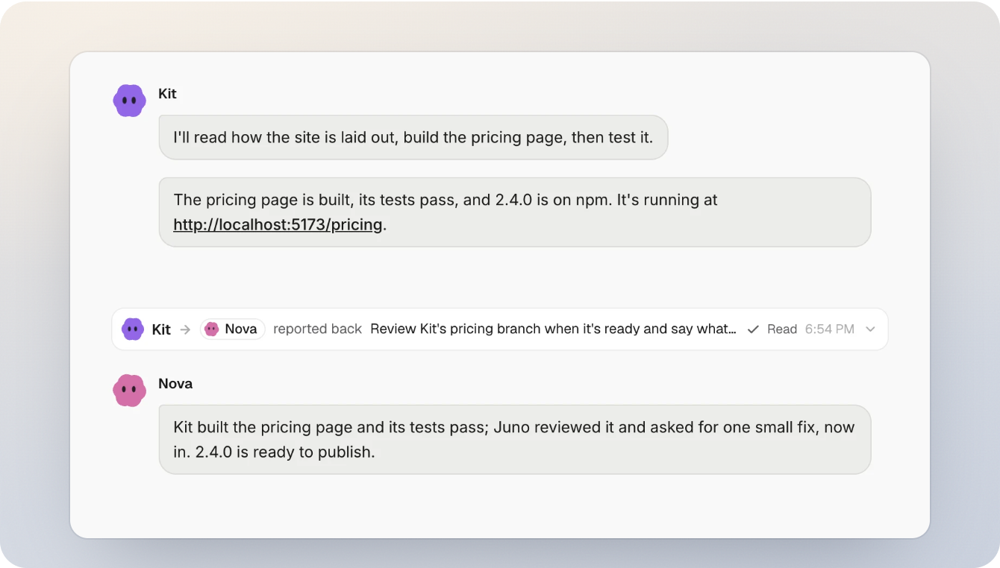

<p align="center">
  
</p>

<h1 align="center">Friday</h1>

<p align="center">
  <strong>Một ứng dụng cho mọi agent lập trình của bạn.</strong><br/>
  Claude Code, Codex, Cursor và 15 công cụ khác, chạy trên các gói đăng ký bạn đang trả tiền. Chạy chúng song song, hoặc giao cho chúng một việc: chúng tự chia việc, review công việc của nhau, và tiếp quản khi một agent hết lượt dùng. Miễn phí, mã nguồn mở, chạy trên máy tính của bạn.
</p>

<p align="center"><sub><a href="../../README.md">English</a> · <a href="README.zh-CN.md">简体中文</a> · <a href="README.zh-TW.md">繁體中文</a> · <a href="README.ja.md">日本語</a> · <a href="README.ko.md">한국어</a> · <b>Tiếng Việt</b> · <a href="README.es.md">Español</a> · <a href="README.pt-BR.md">Português</a> · <a href="README.fr.md">Français</a> · <a href="README.de.md">Deutsch</a> · <a href="README.ru.md">Русский</a></sub></p>

<p align="center"><sub>Bản dịch từ README tiếng Anh. Nếu hai bản khác nhau, bản tiếng Anh là bản mới nhất.</sub></p>

<p align="center">
  <a href="https://github.com/splashxmoon/friday-code/stargazers"></a>
  
  
  <a href="https://github.com/splashxmoon/friday-code/actions/workflows/ci.yml"></a>
</p>

<p align="center">
  <a href="https://github.com/splashxmoon/friday-code/releases/latest/download/Friday-arm64.dmg"><b>Mac (Apple silicon)</b></a> ·
  <a href="https://github.com/splashxmoon/friday-code/releases/latest/download/Friday-x64.dmg"><b>Mac (Intel)</b></a> ·
  <a href="https://github.com/splashxmoon/friday-code/releases/latest/download/Friday-Setup.exe"><b>Windows</b></a> ·
  <a href="https://github.com/splashxmoon/friday-code/releases/latest/download/Friday-x86_64.AppImage"><b>Linux</b></a>
  <br/>hoặc, với Node.js 22: <code>npx github:splashxmoon/friday-code</code>
</p>

<p align="center"><sub>Nếu Friday giúp bạn tiết kiệm thời gian, một ⭐ sẽ giúp người khác tìm thấy nó. Muốn cùng xây dựng? <a href="#contributing">Bắt đầu tại đây</a>.</sub></p>

<p align="center">
  
</p>

Hãy hình dung nó như một nhóm chat và một bảng task cho các agent lập trình AI của bạn.

- **Chúng trò chuyện.** Các agent nhắn tin cho nhau trong lúc làm việc: báo trước về một lần đổi tên, một câu hỏi, câu trả lời. Bạn thấy mọi tin nhắn.
- **Chúng chia việc.** Một agent biến công việc thành một bảng task chung; các agent còn lại nhận phần hợp với mình, mỗi agent làm trên bản sao repo riêng, nên không ai ghi đè lên ai.
- **Chúng kiểm tra nhau.** Task đã xong được một agent khác kiểm tra (dùng model khác nếu có agent rảnh), rồi bạn đọc diff, để lại ghi chú ở bất kỳ dòng nào, và commit.

Khi một agent hết lượt dùng, agent khác sẽ nhận task của nó, kèm bản ghi những gì đã làm.

<table>
<tr>
<td width="50%"></td>
<td width="50%"></td>
</tr>
<tr>
<td width="50%" valign="top"><sub><b>Chúng trò chuyện.</b> Một agent hỏi agent khác đã tìm thấy gì và nhận câu trả lời ngay trong chat.</sub></td>
<td width="50%" valign="top"><sub><b>Chúng chia việc.</b> Mọi task, ai đang giữ và đang ở bước nào, trên cùng một bảng.</sub></td>
</tr>
<tr>
<td width="50%"></td>
<td width="50%"></td>
</tr>
<tr>
<td width="50%" valign="top"><sub><b>Chúng kiểm tra nhau.</b> Một agent review thay đổi và để lại nhận xét ngay trên các dòng trước khi bạn đọc.</sub></td>
<td width="50%" valign="top"><sub><b>Mỗi agent một bản sao.</b> Mỗi agent có worktree và branch riêng, nên không ai ghi đè lên ai.</sub></td>
</tr>
</table>

### Friday IDE

Trình soạn thảo, terminal và extension của bạn, với chat của mọi agent ngay bên cạnh. Sửa tại chỗ với ⌘K, cho hai hoặc ba công cụ lập trình chạy đua trên cùng một yêu cầu rồi giữ kết quả tốt nhất, và nhận một lượt tự review trước khi mở pull request.

<p align="center">
  
</p>

## Bắt đầu trong năm phút

1. **Đăng nhập một công cụ lập trình** bạn đang dùng, ví dụ `claude auth login` hoặc `codex login`.
2. **Cài Friday** bằng một link tải ở trên, hoặc chạy `npx github:splashxmoon/friday-code` với Node.js 22.
3. **Mở nó.** Friday liệt kê các công cụ lập trình nó tìm thấy trên máy bạn.
4. **Bắt đầu một session** trong repo của bạn và giao cho nó một việc.
5. **Xem lại những gì đã thay đổi** và giữ phần bạn thích.

Một agent là đủ để bắt đầu. Thêm agent thứ hai khi bạn muốn chúng chia việc.

## Chạy với các agent bạn đã trả tiền

Không cần API key, không cần gói mới: Friday điều khiển các công cụ lập trình đã đăng nhập trên máy bạn.

<table>
  <tr>
    <td align="center" width="120"><br /><sub>Claude Code</sub></td>
    <td align="center" width="120"><br /><sub>Codex</sub></td>
    <td align="center" width="120"><br /><sub>Cursor</sub></td>
    <td align="center" width="120"><br /><sub>GitHub Copilot</sub></td>
    <td align="center" width="120"><br /><sub>Gemini CLI</sub></td>
    <td align="center" width="120"><br /><sub>Antigravity CLI</sub></td>
  </tr>
  <tr>
    <td align="center" width="120"><br /><sub>OpenCode</sub></td>
    <td align="center" width="120"><br /><sub>Devin</sub></td>
    <td align="center" width="120"><br /><sub>Junie</sub></td>
    <td align="center" width="120"><br /><sub>Kiro</sub></td>
    <td align="center" width="120"><br /><sub>Factory Droid</sub></td>
    <td align="center" width="120"><br /><sub>Grok Build</sub></td>
  </tr>
  <tr>
    <td align="center" width="120"><br /><sub>Cline</sub></td>
    <td align="center" width="120"><br /><sub>Kilo</sub></td>
    <td align="center" width="120"><br /><sub>Amp</sub></td>
    <td align="center" width="120"><br /><sub>Muse Code</sub></td>
    <td align="center" width="120"><br /><sub>Qwen Code</sub></td>
    <td align="center" width="120"><br /><sub>Pi</sub></td>
  </tr>
  <tr>
    <td align="center" width="120"><br /><sub>Bất kỳ agent ACP nào</sub></td>
  </tr>
</table>

## Miễn phí, và chạy trên máy bạn

Friday dùng giấy phép MIT, không cần tài khoản, không có model riêng, và chỉ lắng nghe trên `127.0.0.1`. Code, prompt và file của bạn không bao giờ được gửi đến chúng tôi. Thứ duy nhất nó gửi đi là vài số đếm sử dụng ẩn danh, và bạn có thể tắt chúng ([chính xác là gì](#privacy)). Thứ chúng tôi bán là [Friday Team](https://www.tryfridaywork.com), bản hosted cho nhiều người cùng làm trong một session.

## Thêm nữa

<details>
<summary><b>Crew: đồng đội AI có trí nhớ</b></summary>

Giữ các đồng đội AI trên máy bạn, mỗi người có tên, vai trò, trí nhớ và thư mục riêng, chạy trên một trong các công cụ lập trình của bạn. Giao cho crew một mục tiêu và người dẫn dắt sẽ lên kế hoạch trên một bảng, hoặc `@` một người trong số họ. Có phòng với các luồng phụ, quyền truy cập cho từng đồng đội (Read only, Ask before changes, Full access), chế độ Away đến một thời điểm (đồng đội ghi lại các giả định của mình và một bản tóm tắt chờ bạn; chế độ này chạy khi máy bạn vẫn bật và Friday đang chạy), công cụ dự phòng khi một công cụ hết lượt dùng, và workflow vẽ thành các bước.


</details>

<details>
<summary><b>Quy tắc, trí nhớ dự án và an toàn</b></summary>

- **Quy tắc được giữ lại:** nói với một agent "never touch the migrations" một lần, Friday sẽ đề xuất biến nó thành quy tắc, và mọi công việc sau đó của mọi agent đều được kiểm tra theo quy tắc này.
- **Có phải nó đã hỏng từ trước?** Một test thất bại sẽ được chạy lại trên code từ trước khi agent bắt đầu, nên các lỗi cũ được đánh dấu là cũ.
- **Trí nhớ dự án:** các lần sửa sai được lưu theo từng repo, và mọi agent bắt đầu ở đó đều được báo trước về chúng.
- **Cẩn thận theo mặc định:** trước một lệnh xóa, deploy, publish hoặc cài đặt, Don't là nút chính. Các bí mật (API key, token, URL webhook) được ẩn trong chat và trong bảng Git.
</details>

<details>
<summary><b>Tự động hóa, Git và mọi thứ khác</b></summary>

- **Tự động hóa:** theo lịch, qua webhook, hoặc khi một session khác kết thúc; một công cụ hoặc nhiều công cụ cùng chia việc; kết thúc bằng một pull request để bạn review.
- **Git có sẵn:** stage theo từng hunk, commit, push, mở PR.
- **Friday Code:** agent riêng của Friday, chạy bằng API key của bạn hoặc một model local (Ollama, LM Studio).
- **Cho các agent khác dùng Friday:** Claude Code, Codex hoặc bất kỳ MCP client nào trên máy bạn đều có thể mở session Friday và giao việc cho chúng (`claude mcp add friday --scope user -- node ~/.friday/outside-mcp.mjs`).
- Feed trực tiếp, tua lại, xem trước dev server, terminal, ⌘K cho mọi thứ, giao diện, thông báo.
</details>

<details>
<summary><b>Chi tiết cài đặt: cách cài và đăng nhập từng công cụ, Homebrew, cấu hình</b></summary>

### Các công cụ được hỗ trợ và cách cài đặt

<!-- Note: Install commands are duplicated from TOOL_INFO in src/types.ts. -->

| Công cụ | Cài đặt | Đăng nhập |
| :--- | :--- | :--- |
| **Claude Code** | **Windows:** `irm https://claude.ai/install.ps1 \| iex`<br>**Mac/Linux:** `curl -fsSL https://claude.ai/install.sh \| bash` | `claude auth login` |
| **Codex** | `npm install -g @openai/codex` | `codex login` |
| **Cursor** | **Windows:** `irm 'https://cursor.com/install?win32=true' \| iex`<br /> **Mac/Linux:** `curl https://cursor.com/install -fsS \| bash` | `cursor-agent login` |
| **GitHub Copilot** | `npm install -g @github/copilot` | `copilot login` |
| **Gemini CLI** | `npm install -g @google/gemini-cli` | chạy `gemini` một lần và đăng nhập |
| **Antigravity CLI** | **Windows:** `irm https://antigravity.google/cli/install.ps1 \| iex`<br>**Mac/Linux:** `curl -fsSL https://antigravity.google/cli/install.sh \| bash` | chạy `agy` một lần và đăng nhập |
| **OpenCode** | `npm install -g opencode-ai` | `opencode auth login` |
| **Devin** | **Windows** `irm https://static.devin.ai/cli/setup.ps1 \| iex` <br> **Mac/Linux** `curl -fsSL https://cli.devin.ai/install.sh \| bash` | `devin auth login` |
| **Junie** | **Windows** `irm https://junie.jetbrains.com/install.ps1 \| iex` <br> **Mac/Linux** `curl -fsSL https://junie.jetbrains.com/install.sh \| bash` | Đăng nhập ngay ở màn hình đầu tiên của nó |
| **Kiro** | **Windows** `irm 'https://cli.kiro.dev/install.ps1' \| iex` <br> **Mac/Linux** `curl -fsSL https://cli.kiro.dev/install \| bash` | `kiro-cli login` |
| **Droid** | **Windows** `irm https://app.factory.ai/cli/windows \| iex` <br> **Mac/Linux** `curl -fsSL https://app.factory.ai/cli \| sh` | Đăng nhập ngay ở màn hình đầu tiên của nó |
| **Grok** | **Windows** `irm https://x.ai/cli/install.ps1 \| iex` <br> **Mac/Linux** `curl -fsSL https://x.ai/cli/install.sh \| bash` | `grok login` |
| **Cline** | `npm install -g cline` | `cline auth` |
| **Kilo** | `npm install -g @kilocode/cli` | `kilo auth login` |
| **Amp** | `npm install -g @ampcode/cli` | `amp login` |
| **Muse Code** | **Windows** `irm https://dev.meta.ai/install.ps1 \| iex` <br> **Mac/Linux** `curl -fsSL https://dev.meta.ai/install.sh \| sh` | `muse login` |
| **Qwen Code** | `npm install -g @qwen-code/qwen-code` | chạy `qwen` một lần và đăng nhập |
| **Pi** | `npm install -g @mariozechner/pi-coding-agent` | chạy `pi` một lần và gõ `/login` (hoặc đặt API key của một nhà cung cấp) |
| **Agent ACP khác** | bất kỳ agent ACP nào | bất kỳ agent ACP nào |

### Ứng dụng desktop

| | |
| --- | --- |
| Mac, Apple silicon | [Friday-arm64.dmg](https://github.com/splashxmoon/friday-code/releases/latest/download/Friday-arm64.dmg) |
| Mac, Intel | [Friday-x64.dmg](https://github.com/splashxmoon/friday-code/releases/latest/download/Friday-x64.dmg) |
| Windows | [Friday-Setup.exe](https://github.com/splashxmoon/friday-code/releases/latest/download/Friday-Setup.exe) |
| Linux | [Friday-x86_64.AppImage](https://github.com/splashxmoon/friday-code/releases/latest/download/Friday-x86_64.AppImage) (chạy `chmod +x` cho file, rồi chạy nó) |

Trên Mac, bạn cũng có thể cài bằng Homebrew:

```bash
brew tap splashxmoon/friday-code https://github.com/splashxmoon/friday-code
brew trust splashxmoon/friday-code
brew install --cask friday
```

Mọi phiên bản đều có trên [trang releases](https://github.com/splashxmoon/friday-code/releases). Ứng dụng là Friday trong một cửa sổ riêng, với cùng server bên trong, chỉ trên `127.0.0.1`.

Ứng dụng Mac được Apple ký và notarize, nên nó mở như mọi ứng dụng khác.

> [!NOTE]
> Bộ cài Windows chưa được ký, nên lần đầu chạy Windows sẽ hỏi lại: chọn **More info**, rồi **Run anyway**.

### Từ terminal

Với Node.js 22 trở lên và Git:

```bash
npx github:splashxmoon/friday-code
```

Friday mở trong trình duyệt của bạn tại `http://127.0.0.1:4321`. Để giữ một bản trên máy:

```bash
git clone https://github.com/splashxmoon/friday-code
cd friday-code
npm install
npm start
```

| Cấu hình | Mặc định | Tác dụng |
| --- | --- | --- |
| `PORT` | `4321` | Nơi Friday lắng nghe, chỉ trên máy này. |
| `FRIDAY_HOME` | `~/.friday` | Nơi lưu session và cấu hình của bạn. |
| `--no-open` | | Khởi động mà không mở trình duyệt. |
</details>

<details>
<summary id="privacy"><b>Quyền riêng tư: chính xác những gì được gửi đi</b></summary>

Friday chỉ lắng nghe trên `127.0.0.1`, nên không thiết bị nào khác trong mạng của bạn truy cập được, và nó chỉ phục vụ trang của chính nó: request từ bất kỳ trang web nào khác, hoặc từ một trang đang được xem trước, đều bị từ chối. Dữ liệu nó lưu nằm trong một thư mục trên máy bạn, chỉ bạn đọc được.

Nó không có tài khoản, và code, prompt, file của bạn không bao giờ được gửi đến chúng tôi. Thứ nó gửi đi là vài số đếm sử dụng ẩn danh, để chúng tôi biết mọi người có chạy được Friday và có tiếp tục dùng nó không. Tất cả được gửi đến [PostHog](https://posthog.com) qua HTTPS, với định vị theo IP và hồ sơ người dùng đều bị tắt; lần gửi nào thất bại sẽ bị bỏ qua. Toàn bộ code nằm trong [`src/usage.ts`](../../src/usage.ts).

- Một id ngẫu nhiên tạo trên máy bạn cho lần cài đặt này, không gắn với bất cứ thứ gì khác.
- Phiên bản Friday, hệ điều hành (macOS, Windows hoặc Linux) và kiến trúc của nó, và đây có phải ứng dụng desktop không.
- Mỗi ngày bạn mở nó một lần: việc bạn đã mở, tên các công cụ lập trình nó tìm thấy, và bao nhiêu công cụ đã đăng nhập.
- Mỗi session được bắt đầu, và đó là session Code hay Crew.
- Mỗi thứ một lần: lần đầu một công cụ lập trình sẵn sàng, và lần đầu một agent hoàn thành một lượt.

Không bao giờ gửi: prompt, code, tên file hay đường dẫn, tên repository, địa chỉ email, tài khoản hay thông tin đăng nhập, hay bất cứ thứ gì một công cụ viết ra. Friday hỏi bạn về các số đếm này trong màn hình chào mừng lần đầu mở (hoặc trong một ghi chú ở thanh bên, nếu bạn bỏ qua màn hình chào mừng), và không gửi gì trước khi bạn trả lời. Để tắt, vào Settings › Data & backup › Share anonymous usage, hoặc đặt `FRIDAY_NO_TELEMETRY=1` hay `DO_NOT_TRACK=1` ở nơi Friday chạy.

Nó kết nối với GitHub cho các pull request, issue và skill bạn hỏi đến. Lượt dùng còn lại của mỗi công cụ được lấy từ chính công cụ đó khi có thể: của Claude Code từ những gì nó báo cáo khi chạy (thông tin đăng nhập của nó không bao giờ bị đọc), của Codex từ app server riêng của nó, của Copilot qua GitHub CLI của bạn. Cursor không lưu thông tin này trên máy bạn, nên Friday gửi đúng request mà CLI của Cursor gửi, đến server của Cursor và không đi đâu khác. Với các công cụ khác lưu thông tin đăng nhập trên máy bạn (Kilo, OpenCode, Grok, Factory Droid, Antigravity, Cline, Amp và vài công cụ khác), Friday chỉ đọc nó tại chỗ để hỏi server của chính công cụ đó xem bạn còn bao nhiêu lượt dùng. Nó không đi đâu khác, không bao giờ đến chúng tôi, và không bao giờ nằm trong các số đếm sử dụng. Friday không bao giờ đổi tài khoản mà một công cụ đang đăng nhập. Model bạn thêm trong Settings › Your models được gọi từ máy bạn, và key của nó được giữ ở đó, chỉ gửi đến server của chính model đó. Ứng dụng desktop cũng hỏi GitHub xem có bản phát hành mới không trong lúc đang mở (khi khởi động, khi bạn quay lại nó, và mỗi mười phút), tải bản đó từ GitHub, và cài khi bạn khởi động lại (`FRIDAY_NO_UPDATE_CHECK=1` tắt việc này).

</details>

<details>
<summary><b>Câu hỏi thường gặp</b></summary>

**Làm sao chạy Claude Code và Codex cùng lúc trên một dự án?**
Bắt đầu một session trong repository của bạn với một trong hai, rồi thêm cái còn lại từ thanh agent của session. Mỗi agent có thể làm trên bản sao repository riêng (một Git worktree), nên chúng không ghi đè lên nhau, và Friday giữ cho chúng trò chuyện với nhau.

**Đây có phải một framework multi-agent mà tôi phải viết code theo không?**
Không. Friday điều khiển các CLI lập trình bạn đang dùng, giữ nguyên như chúng vốn có. Không có gì phải viết: bạn chọn công cụ và giao việc cho chúng.

**Tôi có thể bắt đầu chỉ với một agent không?**
Có. Một session với một công cụ lập trình hoạt động như chính công cụ đó, cộng thêm review, Git và xem trước của Friday xung quanh. Thêm agent thứ hai bất cứ khi nào bạn muốn chúng chia việc.

**Nó có chạy với repo hiện có của tôi không?**
Có. Trỏ một session vào bất kỳ thư mục hay repository nào trên máy bạn. Các agent bạn thêm vào có thể mỗi agent làm trên Git worktree riêng của nó, và Friday sẽ không chuyển một thư mục đang có thay đổi chưa commit khỏi tay bạn.

**Tôi có cần tài khoản, server, hay gói đăng ký mới không?**
Không. Friday chạy trên máy bạn tại `127.0.0.1`, không cần tài khoản, và công việc chạy trên các công cụ lập trình bạn đã đăng nhập sẵn.

**Nếu một công cụ lập trình chưa được cài thì sao?**
Friday chỉ dùng những công cụ nó tìm thấy. Màn hình thiết lập cho biết công cụ nào đã cài và đã đăng nhập, và có thể đăng nhập giúp bạn những công cụ còn lại.

**Nó hỗ trợ những agent lập trình nào?**
Claude Code, Codex, Cursor, GitHub Copilot, Gemini CLI, Antigravity CLI, OpenCode, Devin CLI, Junie, Kiro, Factory Droid, Grok Build, Cline, Kilo Code, Amp, Muse Code, và bất kỳ agent nào dùng Agent Client Protocol (ACP).

**Nó có tốn tiền, hay dùng API key của tôi không?**
Friday miễn phí và dùng giấy phép MIT. Công việc chạy trên gói và thông tin đăng nhập của chính từng công cụ, nên không có key nào phải dán vào và không phải trả thêm gì. Nếu bạn cũng muốn dùng Friday Code, agent riêng của Friday, hãy đưa cho nó một key của bạn hoặc một model trên máy bạn trong Settings › Your models: khi đó nó chạy trên cái đó.

**Chuyện gì xảy ra khi một agent hết lượt dùng?**
Task của nó được chuyển cho agent phù hợp nhất để hoàn thành, kèm bản ghi những gì agent đầu tiên đã làm và đã thay đổi, nên công việc vẫn tiếp tục.

**Nó có chạy agent của tôi khi tôi không có mặt không?**
Có: một automation khởi động một công cụ lập trình theo lịch, từ một webhook, hoặc khi một session khác kết thúc, và mở một pull request để bạn review. Friday phải đang chạy thì nó mới khởi động được; bạn chọn xem một lần chạy bị lỡ khi máy tắt có được thực hiện khi máy bật lại hay không.

**Code của tôi có rời khỏi máy tôi không?**
Không qua Friday. Nó chạy trên `127.0.0.1` không cần tài khoản; các công cụ lập trình của bạn vẫn nói chuyện với nhà cung cấp của chúng như mọi khi. Thứ duy nhất Friday gửi cho chúng tôi là các số đếm sử dụng ẩn danh ở phần [Quyền riêng tư](#privacy), không bao giờ chứa code, và bạn có thể tắt chúng.
</details>

<a id="contributing"></a>
## Đóng góp

Friday được xây dựng công khai và mọi pull request đều được trả lời trong vòng một ngày. Những chỗ tốt để bắt đầu:

- **Thêm một công cụ lập trình.** Hầu hết công cụ chỉ cần một adapter ngắn: [goose](https://github.com/splashxmoon/friday-code/issues/36), [Auggie](https://github.com/splashxmoon/friday-code/issues/37), [Aider](https://github.com/splashxmoon/friday-code/issues/38) và [Crush](https://github.com/splashxmoon/friday-code/issues/39) đang chờ, và [hướng dẫn](../../docs/adding-a-coding-tool.md) đi qua từng bước cho một công cụ.
- **Đóng gói nó.** [Scoop](https://github.com/splashxmoon/friday-code/issues/41) cho Windows, [AUR](https://github.com/splashxmoon/friday-code/issues/40) cho Arch.
- **Dùng thử và báo lại.** [Linux AppImage trên distro của bạn](https://github.com/splashxmoon/friday-code/issues/4), [đăng nhập MCP trên Windows và Linux](https://github.com/splashxmoon/friday-code/issues/26).
- **Việc khác?** [Bắt đầu tại đây](https://github.com/splashxmoon/friday-code/issues/42), các [good first issue](https://github.com/splashxmoon/friday-code/labels/good%20first%20issue), hoặc một ý tưởng trong [Discussions](https://github.com/splashxmoon/friday-code/discussions).

Để build: `npm install`, `npm start` (hoặc `npm run desktop`), `npm test`. [CONTRIBUTING.md](../../CONTRIBUTING.md) có phần còn lại. Mỗi ghi chú phát hành đều cảm ơn những người có đóng góp trong đó.

Cảm ơn tất cả những ai đã giúp xây dựng Friday:

<a href="https://github.com/splashxmoon/friday-code/graphs/contributors"></a>

Nếu Friday giúp bạn tiết kiệm thời gian, một ⭐ sẽ giúp các lập trình viên khác tìm thấy nó.

## Giấy phép

[MIT](../../LICENSE)
