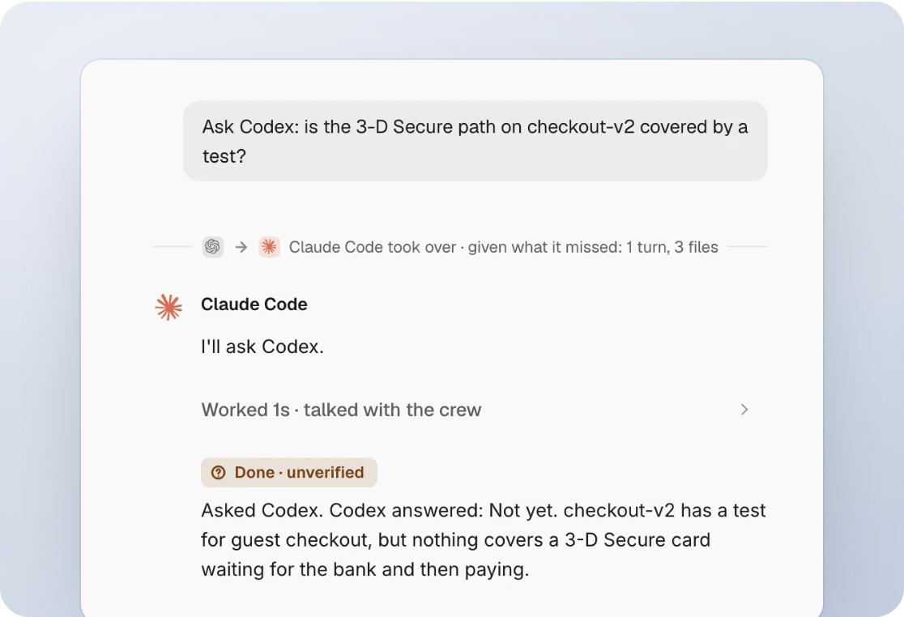
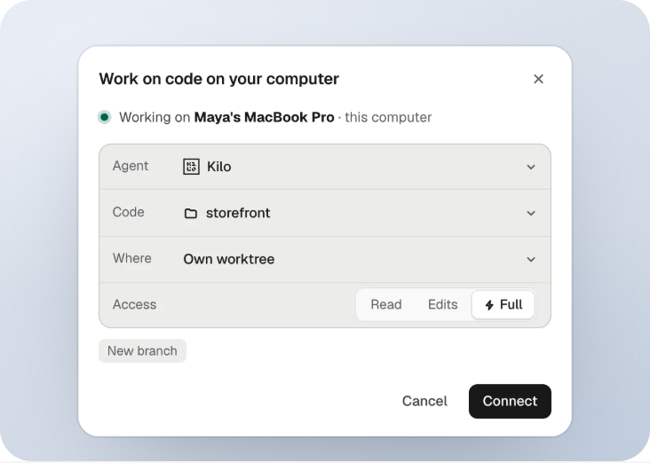
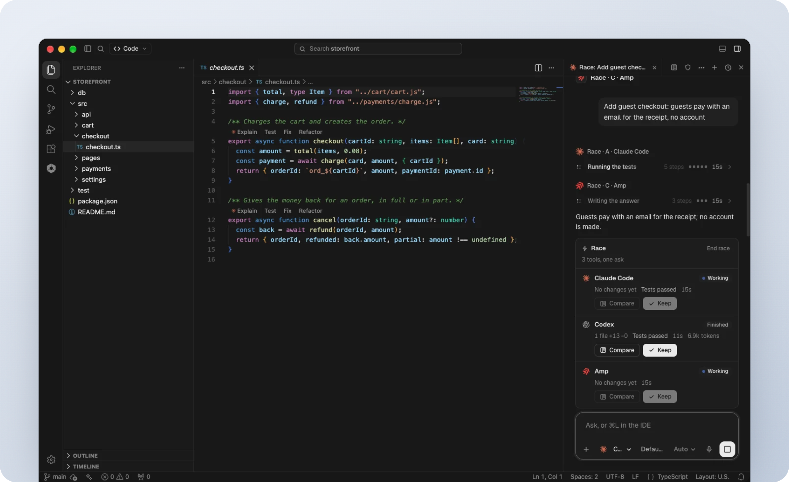

<p align="center">
  
</p>

<h1 align="center">Friday</h1>

<p align="center">
  <strong>一个应用，管好你所有的编程智能体。</strong><br/>
  Claude Code、Codex、Cursor 以及另外 15 款工具，直接用你已经付费的订阅。让它们并排运行，或者交给它们一项任务：它们会拆分工作、互相审查，一个用完额度时另一个接手。免费开源，运行在你自己的电脑上。
</p>

<p align="center"><sub><a href="../../README.md">English</a> · <b>简体中文</b> · <a href="README.zh-TW.md">繁體中文</a> · <a href="README.ja.md">日本語</a> · <a href="README.ko.md">한국어</a> · <a href="README.vi.md">Tiếng Việt</a> · <a href="README.es.md">Español</a> · <a href="README.pt-BR.md">Português</a> · <a href="README.fr.md">Français</a> · <a href="README.de.md">Deutsch</a> · <a href="README.ru.md">Русский</a></sub></p>

<p align="center"><sub>本文译自英文 README。如有出入，以英文版为准。</sub></p>

<p align="center">
  <a href="https://github.com/splashxmoon/friday-code/stargazers"></a>
  
  
  <a href="https://github.com/splashxmoon/friday-code/actions/workflows/ci.yml"></a>
</p>

<p align="center">
  <a href="https://github.com/splashxmoon/friday-code/releases/latest/download/Friday-arm64.dmg"><b>Mac（Apple 芯片）</b></a> ·
  <a href="https://github.com/splashxmoon/friday-code/releases/latest/download/Friday-x64.dmg"><b>Mac（Intel）</b></a> ·
  <a href="https://github.com/splashxmoon/friday-code/releases/latest/download/Friday-Setup.exe"><b>Windows</b></a> ·
  <a href="https://github.com/splashxmoon/friday-code/releases/latest/download/Friday-x86_64.AppImage"><b>Linux</b></a>
  <br/>或者，在 Node.js 22 下运行：<code>npx github:splashxmoon/friday-code</code>
</p>

<p align="center"><sub>如果 Friday 帮你省了时间，点个 ⭐ 能让更多人找到它。想一起开发？<a href="#contributing">从这里开始</a>。</sub></p>

<p align="center">
  
</p>

你可以把它看作 AI 编程智能体的群聊加任务看板。

- **它们会交流。** 智能体在工作中互相发消息：提醒一次重命名、提一个问题、给出答案。每条消息你都看得到。
- **它们会分工。** 一个智能体把任务拆成共享的任务看板，其他智能体认领适合自己的部分，各自在你仓库的独立副本里工作，谁也不会覆盖谁。
- **它们会互查。** 一个任务完成后，由另一个智能体检查（有空闲时换一个不同的模型），然后你阅读 diff，在任意一行留下批注，再提交。

当一个智能体用完额度时，另一个会接手它的任务，并附带一份已完成工作的记录。

<table>
<tr>
<td width="50%"></td>
<td width="50%"></td>
</tr>
<tr>
<td width="50%" valign="top"><sub><b>它们会交流。</b>一个智能体问另一个发现了什么，答案直接回到聊天里。</sub></td>
<td width="50%" valign="top"><sub><b>它们会分工。</b>每个任务、谁在负责、进展如何，都在一个看板上。</sub></td>
</tr>
<tr>
<td width="50%"></td>
<td width="50%"></td>
</tr>
<tr>
<td width="50%" valign="top"><sub><b>它们会互查。</b>在你阅读之前，一个智能体先审查改动，把发现留在对应的行上。</sub></td>
<td width="50%" valign="top"><sub><b>各用各的副本。</b>每个智能体都有自己的 worktree 和分支，谁也不会覆盖谁。</sub></td>
</tr>
</table>

### Friday IDE

你的编辑器、终端和扩展，旁边是每个智能体的聊天。用 ⌘K 原地编辑，让两三个编程工具同时处理一个请求并保留最好的结果，在提交 pull request 之前先做一次自我审查。

<p align="center">
  
</p>

## 五分钟上手

1. **登录一个你已经在用的编程工具**，例如 `claude auth login` 或 `codex login`。
2. **安装 Friday**：使用上方的下载链接，或在 Node.js 22 下运行 `npx github:splashxmoon/friday-code`。
3. **打开它。** Friday 会列出它在你电脑上找到的编程工具。
4. **在你的仓库里开始一个会话**，交给它一项任务。
5. **查看改动**，保留你满意的部分。

一个智能体就够起步了。想让它们分工时，再加第二个。

## 支持你已经付费的智能体

不需要 API 密钥，也不需要新套餐：Friday 驱动的是你电脑上已登录的编程工具。

<table>
  <tr>
    <td align="center" width="120"><br /><sub>Claude Code</sub></td>
    <td align="center" width="120"><br /><sub>Codex</sub></td>
    <td align="center" width="120"><br /><sub>Cursor</sub></td>
    <td align="center" width="120"><br /><sub>GitHub Copilot</sub></td>
    <td align="center" width="120"><br /><sub>Gemini CLI</sub></td>
    <td align="center" width="120"><br /><sub>Antigravity CLI</sub></td>
  </tr>
  <tr>
    <td align="center" width="120"><br /><sub>OpenCode</sub></td>
    <td align="center" width="120"><br /><sub>Devin</sub></td>
    <td align="center" width="120"><br /><sub>Junie</sub></td>
    <td align="center" width="120"><br /><sub>Kiro</sub></td>
    <td align="center" width="120"><br /><sub>Factory Droid</sub></td>
    <td align="center" width="120"><br /><sub>Grok Build</sub></td>
  </tr>
  <tr>
    <td align="center" width="120"><br /><sub>Cline</sub></td>
    <td align="center" width="120"><br /><sub>Kilo</sub></td>
    <td align="center" width="120"><br /><sub>Amp</sub></td>
    <td align="center" width="120"><br /><sub>Muse Code</sub></td>
    <td align="center" width="120"><br /><sub>Qwen Code</sub></td>
    <td align="center" width="120"><br /><sub>Pi</sub></td>
  </tr>
  <tr>
    <td align="center" width="120"><br /><sub>任意 ACP 智能体</sub></td>
  </tr>
</table>

## 免费，并且运行在你的电脑上

Friday 采用 MIT 许可证，没有账号，也没有自己的模型，只监听 `127.0.0.1`。你的代码、提示词和文件从不会发给我们。它唯一发送的是少量匿名使用统计，你可以关闭（[具体内容](#privacy)）。我们出售的是 [Friday Team](https://www.tryfridaywork.com)，也就是供多人在同一个会话中协作的托管版本。

## 更多

<details>
<summary><b>Crew：有记忆的 AI 队友</b></summary>

在你的电脑上组建一支 AI 队友，每个都有名字、角色、记忆和自己的文件夹，运行在你的某个编程工具上。给 crew 一个目标，负责人会在看板上做好计划；也可以直接 `@` 其中一位。支持：带分支话题的房间；按队友设置权限（只读、改动前先询问、完全访问）；离开到指定时间（队友会记下自己的假设，等你回来时有一份简报在等你；前提是电脑保持开机且 Friday 在运行）；一个工具用完额度时的备用工具；以及按步骤绘制的工作流。


</details>

<details>
<summary><b>规则、项目记忆与安全</b></summary>

- **规则会一直生效：** 对智能体说一次“永远别碰 migrations”，Friday 就会把它提议为一条规则，之后每个智能体的工作都会按它检查。
- **是不是本来就坏了？** 失败的测试会在智能体开始之前的代码上重跑一遍，原本就有的失败会被标记为旧问题。
- **项目记忆：** 纠正意见按仓库保存，每个在该仓库启动的智能体都会先收到它们。
- **默认谨慎：** 在执行删除、部署、发布或安装类命令之前，主按钮是 Don't（不执行）。密钥类信息（API 密钥、token、webhook URL）在聊天和 Git 面板中会被隐藏。
</details>

<details>
<summary><b>自动化、Git 及其他</b></summary>

- **自动化：** 按计划、由 webhook 触发，或在另一个会话结束时启动；可以用一个工具，也可以让几个工具分工；最后产出一个 pull request 供你审查。
- **内置 Git：** 按 hunk 暂存、提交、推送、开 PR。
- **Friday Code：** Friday 自己的智能体，使用你自己的 API 密钥或本地模型（Ollama、LM Studio）。
- **让其他智能体使用 Friday：** 你电脑上的 Claude Code、Codex 或任何 MCP 客户端都可以启动 Friday 会话并把工作交给它（`claude mcp add friday --scope user -- node ~/.friday/outside-mcp.mjs`）。
- 实时动态、回退、开发服务器预览、终端、用 ⌘K 完成一切操作、主题、通知。
</details>

<details>
<summary><b>安装详情：各工具的安装与登录、Homebrew、设置</b></summary>

### 支持的工具与安装

<!-- Note: Install commands are duplicated from TOOL_INFO in src/types.ts. -->

| 工具 | 安装 | 登录 |
| :--- | :--- | :--- |
| **Claude Code** | **Windows:** `irm https://claude.ai/install.ps1 \| iex`<br>**Mac/Linux:** `curl -fsSL https://claude.ai/install.sh \| bash` | `claude auth login` |
| **Codex** | `npm install -g @openai/codex` | `codex login` |
| **Cursor** | **Windows:** `irm 'https://cursor.com/install?win32=true' \| iex`<br /> **Mac/Linux:** `curl https://cursor.com/install -fsS \| bash` | `cursor-agent login` |
| **GitHub Copilot** | `npm install -g @github/copilot` | `copilot login` |
| **Gemini CLI** | `npm install -g @google/gemini-cli` | 运行一次 `gemini` 并登录 |
| **Antigravity CLI** | **Windows:** `irm https://antigravity.google/cli/install.ps1 \| iex`<br>**Mac/Linux:** `curl -fsSL https://antigravity.google/cli/install.sh \| bash` | 运行一次 `agy` 并登录 |
| **OpenCode** | `npm install -g opencode-ai` | `opencode auth login` |
| **Devin** | **Windows** `irm https://static.devin.ai/cli/setup.ps1 \| iex` <br> **Mac/Linux** `curl -fsSL https://cli.devin.ai/install.sh \| bash` | `devin auth login` |
| **Junie** | **Windows** `irm https://junie.jetbrains.com/install.ps1 \| iex` <br> **Mac/Linux** `curl -fsSL https://junie.jetbrains.com/install.sh \| bash` | 在它自己的首屏中登录 |
| **Kiro** | **Windows** `irm 'https://cli.kiro.dev/install.ps1' \| iex` <br> **Mac/Linux** `curl -fsSL https://cli.kiro.dev/install \| bash` | `kiro-cli login` |
| **Droid** | **Windows** `irm https://app.factory.ai/cli/windows \| iex` <br> **Mac/Linux** `curl -fsSL https://app.factory.ai/cli \| sh` | 在它自己的首屏中登录 |
| **Grok** | **Windows** `irm https://x.ai/cli/install.ps1 \| iex` <br> **Mac/Linux** `curl -fsSL https://x.ai/cli/install.sh \| bash` | `grok login` |
| **Cline** | `npm install -g cline` | `cline auth` |
| **Kilo** | `npm install -g @kilocode/cli` | `kilo auth login` |
| **Amp** | `npm install -g @ampcode/cli` | `amp login` |
| **Muse Code** | **Windows** `irm https://dev.meta.ai/install.ps1 \| iex` <br> **Mac/Linux** `curl -fsSL https://dev.meta.ai/install.sh \| sh` | `muse login` |
| **Qwen Code** | `npm install -g @qwen-code/qwen-code` | 运行一次 `qwen` 并登录 |
| **Pi** | `npm install -g @mariozechner/pi-coding-agent` | 运行一次 `pi` 并输入 `/login`（或设置某个提供商的 API 密钥） |
| **其他 ACP 智能体** | 任意 ACP 智能体 | 任意 ACP 智能体 |

### 桌面应用

| | |
| --- | --- |
| Mac，Apple 芯片 | [Friday-arm64.dmg](https://github.com/splashxmoon/friday-code/releases/latest/download/Friday-arm64.dmg) |
| Mac，Intel | [Friday-x64.dmg](https://github.com/splashxmoon/friday-code/releases/latest/download/Friday-x64.dmg) |
| Windows | [Friday-Setup.exe](https://github.com/splashxmoon/friday-code/releases/latest/download/Friday-Setup.exe) |
| Linux | [Friday-x86_64.AppImage](https://github.com/splashxmoon/friday-code/releases/latest/download/Friday-x86_64.AppImage)（先 `chmod +x`，再运行） |

在 Mac 上也可以用 Homebrew 安装：

```bash
brew tap splashxmoon/friday-code https://github.com/splashxmoon/friday-code
brew trust splashxmoon/friday-code
brew install --cask friday
```

所有版本都在[发布页面](https://github.com/splashxmoon/friday-code/releases)上。这个应用就是在独立窗口中运行的 Friday，内置同样的服务器，同样只监听 `127.0.0.1`。

Mac 应用已经过 Apple 签名和公证，打开方式和其他应用一样。

> [!NOTE]
> Windows 安装程序暂未签名，所以第一次运行时 Windows 会先询问：选择 **更多信息**，再选择 **仍要运行**。

### 从终端运行

需要 Node.js 22 或更新版本，以及 Git：

```bash
npx github:splashxmoon/friday-code
```

Friday 会在浏览器中打开 `http://127.0.0.1:4321`。想在本地保留一份：

```bash
git clone https://github.com/splashxmoon/friday-code
cd friday-code
npm install
npm start
```

| 设置 | 默认值 | 作用 |
| --- | --- | --- |
| `PORT` | `4321` | Friday 监听的端口，仅限本机。 |
| `FRIDAY_HOME` | `~/.friday` | 存放你的会话和设置的位置。 |
| `--no-open` | | 启动时不打开浏览器。 |
</details>

<details>
<summary id="privacy"><b>隐私：具体发送了什么</b></summary>

Friday 只监听 `127.0.0.1`，所以你网络中的其他设备都无法访问它。它也只响应自己的页面：来自其他任何网站或正在预览的页面的请求都会被拒绝。它保存的只有你电脑上的一个文件夹，而且只有你能读取。

它没有账号，你的代码、提示词和文件从不会发给我们。它确实会发送少量匿名使用统计，让我们了解大家能否顺利用起 Friday、是否会继续使用。所有统计都通过 HTTPS 发往 [PostHog](https://posthog.com)，并关闭了基于 IP 的定位和用户画像；发送失败的数据直接丢弃。相关代码全部在 [`src/usage.ts`](../../src/usage.ts) 中。

- 一个在你电脑上为本次安装生成的随机 ID，不关联任何其他信息。
- Friday 的版本、你的系统（macOS、Windows 或 Linux）及其架构，以及是否为桌面应用。
- 你打开它的日子，每天一次：你打开了它、它找到的编程工具名称，以及其中有几个已登录。
- 每次开始会话，以及它是 Code 会话还是 Crew 会话。
- 各记录一次：第一次有编程工具就绪，以及第一次有智能体完成一轮工作。

从不发送：提示词、代码、文件名或路径、仓库名、邮箱地址、账号或登录信息，以及工具写出的任何内容。Friday 第一次打开时会在欢迎页询问你是否同意这些统计（如果你跳过欢迎页，则在侧边栏中以提示的形式询问），在你回答之前不会发送任何内容。要关闭统计，可以使用 Settings › Data & backup › Share anonymous usage，或在运行 Friday 的环境中设置 `FRIDAY_NO_TELEMETRY=1` 或 `DO_NOT_TRACK=1`。

当你询问 pull request、issue 和技能时，它会与 GitHub 通信。每个工具的剩余额度尽可能从工具本身获取：Claude Code 的来自它运行时的报告（从不读取它的登录信息），Codex 的来自它自己的 app server，Copilot 的通过你的 GitHub CLI 获取。Cursor 不在你的电脑上保存这些信息，所以 Friday 会发出与 Cursor 自己的 CLI 相同的请求，只发往 Cursor 的服务器，不发往别处。对于其他在你电脑上保存登录信息的工具（Kilo、OpenCode、Grok、Factory Droid、Antigravity、Cline、Amp 等），Friday 只在本地读取登录信息，用来向该工具自己的服务器查询你还剩多少额度。这些信息不会发往别处，绝不会发给我们，也绝不会进入使用统计。Friday 从不切换工具所登录的账号。你在 Settings › Your models 中添加的模型从你的电脑直接调用，它的密钥保存在本地，只发送给该模型自己的服务器。桌面应用在打开期间还会向 GitHub 查询新版本（启动时、你切回应用时，以及每十分钟一次），从 GitHub 下载，并在你重启时安装（设置 `FRIDAY_NO_UPDATE_CHECK=1` 可关闭）。

</details>

<details>
<summary><b>常见问题</b></summary>

**怎样在同一个项目上同时运行 Claude Code 和 Codex？**
先用其中一个在你的仓库里开始会话，再从会话的智能体栏里添加另一个。它们各自可以在仓库的独立副本（Git worktree）中工作，不会互相覆盖，Friday 会让它们保持沟通。

**这是一个需要我写代码去对接的多智能体框架吗？**
不是。Friday 直接驱动你已经在用的编程 CLI，原样使用。没有任何代码要写：你选好工具，把任务交给它们就行。

**可以只用一个智能体开始吗？**
可以。只有一个编程工具的会话，用起来就像这个工具本身，外加 Friday 的审查、Git 和预览。想让它们分工时，随时再加第二个智能体。

**能用在我现有的仓库上吗？**
能。把会话指向你电脑上的任意文件夹或仓库即可。你添加的每个智能体都可以在它的 Git worktree 中工作；如果某个文件夹里有未提交的改动，Friday 不会在你不知情时切换它。

**需要账号、服务器或新的订阅吗？**
不需要。Friday 在你的电脑上运行于 `127.0.0.1`，没有账号，工作都由你已经登录的编程工具完成。

**如果某个编程工具没有安装呢？**
Friday 只使用它找到的工具。它的设置页会显示哪些已安装、哪些已登录，并能帮你登录其余的工具。

**支持哪些编程智能体？**
Claude Code、Codex、Cursor、GitHub Copilot、Gemini CLI、Antigravity CLI、OpenCode、Devin CLI、Junie、Kiro、Factory Droid、Grok Build、Cline、Kilo Code、Amp、Muse Code，以及任何支持 Agent Client Protocol（ACP）的智能体。

**要花钱吗？会用我的 API 密钥吗？**
Friday 免费，采用 MIT 许可证。工作使用每个工具自己的套餐和登录，所以不用粘贴密钥，也不用额外付费。如果你还想用 Friday 自己的智能体 Friday Code，可以在 Settings › Your models 中给它一个你自己的密钥或你电脑上的模型，它就会用那个来运行。

**一个智能体用完额度时会怎样？**
它的任务会交给最适合完成它的智能体，并附带第一个智能体做过什么、改了什么的记录，工作不会中断。

**我不在的时候，它能运行我的智能体吗？**
能。自动化可以按计划、由 webhook 触发，或在另一个会话结束时启动一个编程工具，并开一个 pull request 供你审查。Friday 必须在运行才能启动它；电脑关机期间错过的运行，在开机后是否补跑由你决定。

**我的代码会离开我的电脑吗？**
不会经过 Friday。它运行在 `127.0.0.1`，没有账号；你的编程工具照常与它们各自的服务商通信。Friday 发给我们的只有[隐私](#privacy)中列出的匿名使用统计，其中从不包含代码，而且你可以关闭。
</details>

<a id="contributing"></a>
## 参与贡献

Friday 公开开发，每个 pull request 都会在一天内得到回复。适合入手的地方：

- **添加一个编程工具。** 大多数工具只需要一个简短的适配器：[goose](https://github.com/splashxmoon/friday-code/issues/36)、[Auggie](https://github.com/splashxmoon/friday-code/issues/37)、[Aider](https://github.com/splashxmoon/friday-code/issues/38) 和 [Crush](https://github.com/splashxmoon/friday-code/issues/39) 正等着有人来做，[这份指南](../../docs/adding-a-coding-tool.md)会带你完整做一遍。
- **打包。** Windows 的 [Scoop](https://github.com/splashxmoon/friday-code/issues/41)，Arch 的 [AUR](https://github.com/splashxmoon/friday-code/issues/40)。
- **试用并反馈。** [在你的发行版上运行 Linux AppImage](https://github.com/splashxmoon/friday-code/issues/4)，[Windows 和 Linux 上的 MCP 登录](https://github.com/splashxmoon/friday-code/issues/26)。
- **想做别的？** [从这里开始](https://github.com/splashxmoon/friday-code/issues/42)，看看 [good first issues](https://github.com/splashxmoon/friday-code/labels/good%20first%20issue)，或者在 [Discussions](https://github.com/splashxmoon/friday-code/discussions) 里提出想法。

构建方法：`npm install`、`npm start`（或 `npm run desktop`）、`npm test`。其余内容见 [CONTRIBUTING.md](../../CONTRIBUTING.md)。每份发布说明都会感谢为该版本出力的人。

感谢所有帮助构建 Friday 的人：

<a href="https://github.com/splashxmoon/friday-code/graphs/contributors"></a>

如果 Friday 帮你省了时间，点个 ⭐ 能让更多开发者找到它。

## 许可证

[MIT](../../LICENSE)
