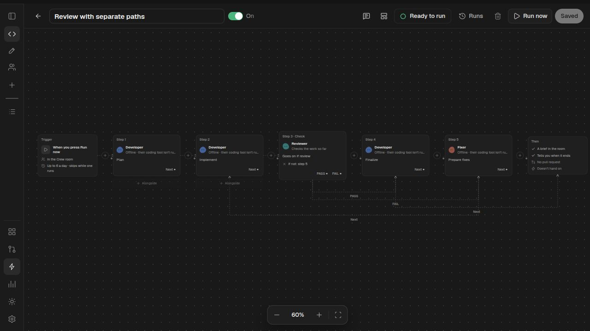

# Connections between workflow steps

Workflows keep their existing columns, teammates and account selections. Steps in a column still run together. An explicit connection enters the destination's column; it doesn't change who does that work.

Drag a card's **Next**, **PASS** or **FAIL** output onto a destination card. You can also click the output, then the destination's input dot. Select a branch wire to open its step's settings. The **Next connection**, **PASS connection** and **FAIL connection** menus offer the same choices on narrow screens and from the keyboard. **Reset connection** removes an override and restores the existing next-column or configured failure action.

For separate review paths, add these steps in their own columns:

1. Plan → Implement → Review (a Check).
2. Set Review's PASS connection to Finalize, and its FAIL connection to Prepare fixes.
3. Set Finalize's Next connection to Finish the run.
4. Give Prepare fixes its own instructions and teammate; connect its Next output back to Implement.

Only the selected path runs. PASS skips the fixes; FAIL visits the fixes and then returns to implementation and review. A check still has its existing retry limit (default three, maximum five). Explicit connections also stop after 100 transitions, including successful backward connections. A failed agent execution stops the run; it doesn't select a different path, tool or account.

Deleting a destination leaves a readiness error until you reconnect or reset that output. Existing saved workflows need no migration. Work steps with explicit outgoing connections stand alone in their column, just as checks and approvals do. Approval steps still wait for your answer. A FAIL connection to Finish stops the run; it doesn't report a successful result.

This adds conditional connections to the existing runner. It doesn't introduce general repeat nodes, arbitrary expressions, a second workflow engine, or automatic account switching.
